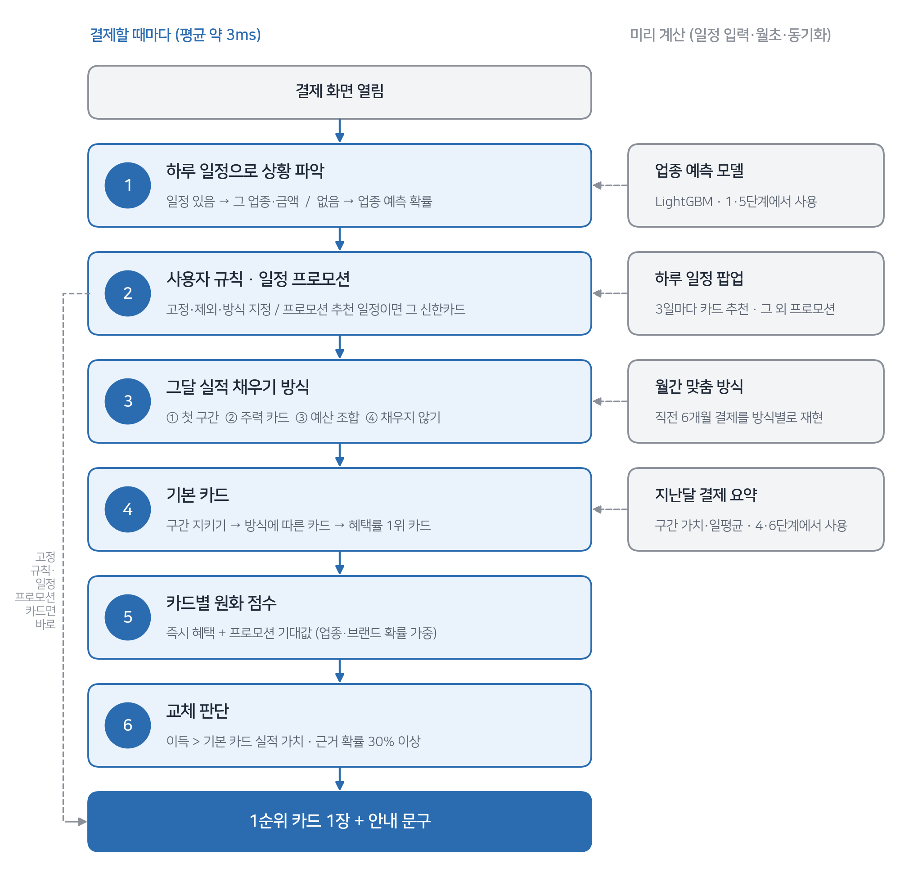

**PayMate 카드 배치 알고리즘 설계서 v4.2**

Nov 18, 2026 · @방진우

## 한눈에 보기

PayMate 카드 배치 알고리즘은 결제 화면을 열 때 **하루 일정, 사용자 규칙, 그달의 실적 채우기 방식, 카드별 예상 혜택(즉시 혜택 + 프로모션)**을 차례로 따져 1순위 카드 한 장을 제안합니다. 결제 카드는 사용자가 최종 선택합니다. 하루 일정을 입력하면 3일에 한 번은 새 신한카드를, 그 외의 날에는 일정에 맞는 프로모션을 팝업으로 알려 줍니다.

실제 카드 40장의 구조화된 혜택, SOL페이 이벤트·마이샵 프로모션 29건, 가상 사용자 365명의 1년 결제로 2026년 1월 1일~11월 5일을 재생했습니다. 2025년 11~12월은 이력으로만 씁니다. 프로모션 29건은 원래 2026년 11월 행사이지만 **데이터 전체 기간(2025년 11월~)에 있는 행사로 가정**했습니다. 마이샵 행사는 혜택을 켜(ON) 둬야 받으므로, **습관대로 결제하는 고객은 마이샵 행사의 30%만 켰다고** 봅니다. 사용자는 항상 1순위 카드로 결제하고, 일부 결제는 하루 일정으로 미리 입력한다고 봅니다.

| **기준** | **혜택률** | **받은 혜택** | **조건** |
|----|----|----|----|
| 습관대로 결제 | 0.824% | 49,808,530원 | 가상 결제의 원래 카드 |
| 이 엔진 (일정 입력 + 일정 팝업) | 1.320% | 79,760,870원 | 일부 결제를 일정으로 입력, 일정 맞춤 프로모션 추천 |
| 사후 최적 상한 | 1.716% | 103,695,790원 | 결제를 전부 미리 안다고 할 때의 최대치 |

- 습관 대비 더 받을 수 있는 몫(사후 최적 상한 − 습관) 중 **55.6%**를 가져옵니다. 사용자별 혜택 증가액(10개월여 합계)의 중앙값은 54,020원입니다.

- 365명 중 6명(1.6%)은 습관보다 혜택이 줄었습니다. 감소액 중앙값은 3,555원입니다.

- 기본 카드는 **'지난달 받던 구간을 이번 달에 놓칠 카드'를 먼저 챙기고**, 그다음 그달 실적 채우기 방식에 따라 정합니다. 방식 ①은 구간 가치가 큰 카드부터 채웁니다.

- 다른 카드로 바꾸는 기준은 **기본 카드로 이 결제를 냈을 때 쌓이는 실적 가치(원)**입니다. 결제 금액과 구간 가치에 비례합니다.

- **프로모션도 원화 점수에 넣습니다.** 결제 화면을 여는 순간에는 가게를 모르므로, 그 업종에서 사용자가 갈 브랜드의 비중으로 행사 금액의 기대값을 셉니다. 한 결제에는 행사 하나(가장 큰 것)만 붙습니다.

- **하루 일정 팝업**은 일정에 맞는 행사를 미리 알려 주고, 그 일정 시간에는 그 행사를 받으면서 건당 혜택도 가장 큰 **신한카드를 1순위**로 둡니다.

- 머신러닝(LightGBM)은 '지금 어떤 업종에서 결제할지' 예측에 씁니다. 금액은 모두 엔진이 계산하고, 생성형 AI는 숫자를 만들지 않습니다.

- 모든 수치는 구현한 엔진 코드(solpay-ai)로 재생한 값입니다.

## 용어 정리

이 문서에 나오는 말의 뜻입니다. 카드사가 쓰는 말을 그대로 쓰되, 이 알고리즘에서 정한 말은 따로 표시했습니다.

| **용어** | **뜻** |
|----|----|
| 실적 | 한 달 동안 그 카드로 결제한 금액 합계 |
| 전월 실적 | 지난달 실적. 대부분의 카드는 전월 실적에 따라 이번 달 혜택을 줍니다 |
| 구간 | 전월 실적에 따라 혜택이 달라지는 단계. 예: 전월 40만 원 이상이면 월 8천 원까지, 80만 원 이상이면 1만 5천 원까지 |
| 지난달 받던 구간 (이 알고리즘의 말) | 지난달 실적으로 이번 달에 받고 있는 가장 높은 구간. 이번 달 실적이 이 구간에 못 미치면 다음 달에는 그 혜택이 줄어듭니다 |
| 실적을 채운다 | 다음 달에 더 높은(또는 지금의) 구간 혜택을 받기 위해 이번 달 그 카드로 결제를 모으는 것 |
| 구간 지키기 (이 알고리즘의 말) | 지난달 받던 구간을 이번 달에 놓칠 카드가 있으면, 그 카드를 먼저 기본 카드로 두는 것 |
| 한도 | 한 달에 받을 수 있는 혜택의 최대치. 여러 혜택이 한도 하나를 함께 쓰기도 합니다 |
| 무실적 카드 | 전월 실적과 관계없이 늘 같은 혜택을 주는 카드. 예: 국내 가맹점 1%(KB ALL) |
| 브랜드 한정 혜택 | 스타벅스·CU·이마트처럼 정해진 브랜드에서만 받는 혜택 |
| 현장 결제 | 매장에서 SOL페이 화면을 열고 QR·바코드로 하는 결제. 알고리즘이 카드를 정하는 대상입니다 |
| 고정 결제 | 온라인 결제·자동이체·교통카드처럼 사용자가 정해 둔 카드로 나가는 결제. 카드를 바꾸지 않지만 실적에는 들어갑니다 |
| 1순위 카드 | 결제 화면에 보여 주는 카드. 항상 한 장입니다 |
| 기본 카드 (이 알고리즘의 말) | 특별한 이유가 없을 때 1순위에 두는 카드. 보통 지금 실적을 채우는 카드입니다 |
| 실적 채우기 방식 | 실적을 채울 카드가 여럿일 때 어느 카드부터 채울지 정한 방법. ①~④ 네 가지 |
| 월간 맞춤 방식 (이 알고리즘의 말) | 매달 초 직전 6개월의 본인 결제를 방식마다 다시 돌려 보고, 혜택이 가장 큰 방식을 그달에 쓰는 것 |
| 구간 가치 (이 알고리즘의 말) | 어떤 카드가 한 구간 올라가면 다음 달에 더 받을 수 있는 금액. 다른 카드로도 어차피 받는 혜택은 빼고 셉니다 |
| 실적 가치 (이 알고리즘의 말) | 이 결제를 그 카드로 냈을 때 다음 구간에 가까워지는 값을 원으로 바꾼 것. 6단계 교체 기준으로 씁니다 |
| 근거 확률 | 1위 카드가 기본 카드보다 더 주는 업종들의 확률 합 |
| 하루 일정 | 사용자가 미리 입력한 그날의 일정(시간·업종·예상 금액). 일정 시간대에는 그 업종으로 보고 카드를 고릅니다 |
| 반복 구간 | 같은 요일·시간대에 결제가 8건 이상이고 한 업종이 절반 이상인 경우. 예: 평일 오전 8시마다 카페 |
| 습관대로 결제 | 알고리즘 없이 사용자가 평소 쓰던 카드로 결제한 경우. 평가의 기준입니다 |
| 사후 최적 상한 | 결제를 전부 미리 안다고 할 때, 카드를 골라 받을 수 있는 혜택의 최대치. 알고리즘과 무관하게 따로 계산합니다 |
| 과거 결제 재현 평가 | 과거 결제를 시간 순서대로 다시 흘려 보며, 그 시점까지의 정보만으로 알고리즘이 카드를 고르게 하는 평가 |
| 프로모션 | SOL페이 이벤트와 마이샵 혜택(신한카드 결제 대상). 5단계 원화 점수에 넣고, 하루 일정 팝업에서도 안내합니다 |
| 마이샵 ON | 마이샵 행사는 사용자가 앱에서 그 혜택을 켜(ON) 둬야 받습니다. SOL페이 이벤트는 켤 필요가 없습니다 |
| 프로모션 기대값 (이 알고리즘의 말) | 이 카드로 지금 결제할 때 받을 행사 금액의 기대값. 가게를 모르면 업종 안 브랜드 비중으로 셉니다 |
| 일정 팝업 (이 알고리즘의 말) | 하루 일정을 저장하면 띄우는 안내. 3일에 한 번은 새 신한카드 추천, 그 외의 날은 일정에 맞는 프로모션 추천 |
| 프로모션 카드 (이 알고리즘의 말) | 프로모션을 추천한 일정 시간에 1순위로 두는 신한카드. 그 프로모션을 받으면서 건당 혜택이 가장 큰 카드 |

## 해결하려는 문제와 목표

카드를 여러 장 가진 사람도 결제할 때는 거의 늘 쓰던 카드를 냅니다. 카드마다 혜택 조건이 너무 다양해서, 계산대 앞에서 따져 보기 어렵기 때문입니다. 실제 카드 혜택 예시입니다.

- **신한카드 Discount Plan+**: 전월 40만 원 이상이면 오전 7시~오후 3시 스타벅스·메가MGC커피·이디야·커피빈 10% 할인. 결제 1건당 최대 1천 원, 하루 1번, 묶음 월 한도 5천 원(전월 180만 원 이상이면 2만 원).

- **신한 모두의카드**: 전월 30만 원 이상이면 2만 원 이상 간편결제 5% 할인(건당 최대 3천 원, 하루 1번). 카드 전체 월 한도 7천 원(전월 60만 원 이상이면 1만 5천 원).

- **NH농협 올원더풀(할인 PACK)**: 전월 40만 원 이상이면 백화점·대형마트 5%, 병원·약국 10% 할인. 묶음마다 월 8천 원(전월 80만 원 이상이면 1만 5천 원).

- **KB ALL 카드**: 조건 없이 국내 가맹점 1% 청구할인.

같은 스타벅스 4,800원 결제도 시간·이번 달 남은 한도·지난달 실적에 따라 가장 좋은 카드가 달라집니다. 또 이번 달 어느 카드로 결제하느냐가 다음 달 혜택을 바꿉니다. 목표는 세 가지입니다.

1.  **더 많은 혜택**: 사용자가 쓰는 돈은 바꾸지 않고, 카드 선택만으로 받는 혜택을 늘립니다. 소비를 늘리라는 안내는 하지 않습니다.

2.  **간단한 화면**: 카드는 항상 한 장만 보여 주고, 결제마다 1순위가 자주 바뀌지 않게 기본 카드를 둡니다.

3.  **빠르고 설명할 수 있는 계산**: 화면을 열 때 1초 안에 답하고, 왜 이 카드인지 원 단위 금액으로 설명합니다.

## 데이터: 실제 카드와 가상 결제

카드와 혜택은 팀 최종 DB(카드서비스_DB)의 실제 데이터입니다. 사용자와 결제는 실제 데이터가 없어서 만든 가상 데이터이며, 같은 형식으로 카드서비스_DB_1년에 담았습니다.

### 카드와 혜택

| **항목** | **내용** |
|----|----|
| 카드 | 40장. 신한 14 · KB 6 · 하나 6 · BC 5 · NH 5 · 롯데 4 |
| 혜택 | 283개. 전월 실적 구간별로 나누면 632행이며, 구간별 한도·혜택 묶음 한도·카드 통합 한도를 모두 담습니다 |
| 업종 | 58개 (카페, 음식점, 편의점, 대형마트, 백화점, 병원, 디지털 구독 등) |
| 브랜드 | 209개와 별칭 41개 (예: '스벅' → 스타벅스) |
| 프로모션 | 29건 (SOL페이 이벤트 6 · 마이샵 23, 신한카드 결제 대상). 원본: SOL 페이 혜택 정보.xlsx의 2026년 11월 행사 31건 중 가맹점을 식별할 수 없는 2건을 뺀 것. 데이터 전체 기간(2025-11-01~원래 종료일)에 있는 행사로 보고 팀 DB(카드서비스_DB_1년)의 promotions 표에 넣었습니다(마이샵/이벤트 구분·최소 결제액 칸 추가) |

### 혜택 계산 규칙

결제 한 건의 혜택은 아래 순서로 계산합니다. 가상 결제를 만드는 쪽과 배치 엔진이 똑같은 계산 코드를 써서, 평가와 실제 동작의 계산이 다르지 않습니다.

1.  그 결제에 해당하는 혜택을 찾습니다. 업종이 맞거나, 브랜드 한정 혜택이면 브랜드가 맞아야 합니다.

2.  조건을 확인합니다. 건당 최소 금액, 전월 실적 구간(구간마다 다른 행), 요일·날짜·시간, 결제수단(SOL페이 현장 결제는 간편결제로 봄), 이번 달·오늘 사용 횟수, 한도 묶음의 대상 구간입니다.

3.  금액을 계산합니다. 비율 혜택은 10원 미만을 버리고, 정액 혜택은 결제액을 넘지 않습니다. 주유 리터당 할인은 결제액을 리터당 1,700원으로 나눠 리터로 바꿉니다.

4.  한도로 자릅니다. 건당 최대 → 묶음 월 한도의 남은 액 → 혜택별 월 한도 → 카드 통합 월 한도 순서입니다. "월 5만 원 결제분까지"처럼 결제액으로 정한 한도는 계산 대상 금액을 자릅니다.

5.  해당하는 혜택이 여럿이면 가장 큰 것 하나만 받습니다. 포인트·캐시백·할인은 모두 1포인트 = 1원으로 봅니다.

### 가상 사용자와 결제

| **항목** | **내용** |
|----|----|
| 사용자 | 365명. 시연용 5명(직장인, 대학생, 50대 주부, 야근 직장인, 재택 근무자) + 평가용 360명 |
| 보유 카드 | 2~4장 (2장 145명, 3장 106명, 4장 114명). 모두 신한카드를 1장 이상 가지고, 60%는 타사 카드도 가집니다. 시연용 test2·test3에는 신한카드가 없어 4번째 카드로 신한카드를 더했습니다 |
| 가맹점 | 907곳 (서울·분당 생활권의 실제 가게와 온라인 가맹점) |
| 결제 | 2025년 11월 1일~2026년 11월 5일, 447,808건. 현장 QR 186,322건 · 교통 205,005건 · 온라인 35,334건 · 자동이체 21,147건. 카드는 혜택과 상관없는 습관으로 고릅니다 |

타사 카드 결제는 마이데이터로 다음 날 반영되는 것으로 보고, 그때까지는 실적에 넣지 않고 계산합니다.

## 전체 흐름

결제 화면을 열 때마다 아래 여섯 단계를 거쳐 1순위 카드 한 장을 정합니다. 오른쪽 네 가지는 일정을 입력할 때, 월초, 결제 동기화 때 미리 계산해 두고, 결제 요청에서는 읽기만 합니다.

그림 1. 카드 배치 파이프라인

| **단계** | **하는 일** | **쓰는 정보** | **결과** |
|----|----|----|----|
| 1\. 하루 일정으로 상황 파악 | 지금 결제할 업종·금액·브랜드를 확률로 정리 | 하루 일정, 업종 예측 모델, 결제 이력 | 상황 목록 (예: 카페 55%, 4,800원) |
| 2\. 사용자 규칙 · 일정 프로모션 | 고정·제외·방식 지정·성향 적용. 프로모션을 추천한 일정 시간이면 그 프로모션 카드 | 챗봇으로 확정한 규칙, 일정 팝업 결과 | 후보 카드. 고정 규칙이나 프로모션 카드면 바로 결과 |
| 3\. 실적 채우기 방식 | 그달 방식 확인 | 월초에 고른 방식, 사용자 확정 | 방식 ①~④ 중 하나 |
| 4\. 기본 카드 | 구간 지키기 → 방식 → 혜택률 1위 | 당월·전월 실적, 구간 가치, 남은 예상 결제 | 기본 카드 1장 |
| 5\. 원화 점수 | 카드마다 즉시 혜택 + 프로모션 기대값 | 혜택 규칙, 남은 한도·횟수, 진행 중인 행사, 브랜드 비중 | 카드별 점수(원) |
| 6\. 교체 판단 | 점수 1위 카드로 바꿀지 | 점수 차이, 기본 카드 실적 가치, 근거 확률 | 1순위 카드 + 안내 문구 |

월간 맞춤 방식 계산은 1인당 1초 안팎이라 월초 배치나 마이데이터 동기화 때 미리 해 둡니다. 결제 요청 한 건의 계산은 평균 2.6ms입니다.

## 1단계: 하루 일정으로 상황 파악

결제 화면을 연 순간에는 어디서 얼마를 결제할지 아직 모릅니다. 그래서 업종·금액·브랜드를 확률로 정리합니다. 예를 들어 "카페 55%(예상 4,800원), 음식점 30%(9,000원), 편의점 15%(3,500원)"처럼입니다. 이렇게 나온 가능성 하나하나를 '상황'이라고 부르고, 5단계에서 상황마다 카드 혜택을 계산합니다.

일정은 결제 상황을 알려 주는 정보라 가장 먼저 봅니다. 일정이 정하는 것은 '지금 어떤 상황인가'이고, 어떤 카드를 쓸지는 2단계 규칙과 4~6단계가 정합니다.

### 업종

- **하루 일정이 있을 때**: 일정 시작 30분 전부터 끝 30분 후까지는 그 일정의 업종·금액으로 봅니다. 그 사이에 같은 업종 현장 결제가 이미 있으면 그 일정은 끝난 것으로 봅니다. 일정은 시간·업종·예상 금액만 받고, 장소나 메모는 받지 않으며 그날이 지나면 지웁니다.

- **일정이 없을 때**: 업종 예측 모델(LightGBM)이 업종별 확률을 냅니다. 확률이 2% 미만인 업종은 빼고, 나머지의 합이 1이 되게 다시 나눕니다.

- **반복 구간**: 같은 요일·시간대에 결제가 8건 이상 있고 한 업종이 절반 이상이면, 그 업종 하나(100%)로 봅니다.

위치(GPS)는 쓰지 않습니다(2026-11-14 결정). 가맹점이 붙어 있으면 잘못 안내하기 쉽고, 계산이 복잡하며, 배터리를 씁니다.

### 금액

그 가맹점에서 낸 금액의 중앙값을 예상 금액으로 씁니다. 가맹점 이력이 5건보다 적으면 그 업종 금액의 중앙값을, 그것도 적으면 전체 사용자의 업종 중앙값(그달 1일 이전 결제 기준)을 씁니다. 일정에 금액을 적었으면 그 금액을 씁니다. 중앙값을 쓰는 것은 가끔 있는 큰 결제에 예상 금액이 휘둘리지 않게 하기 위해서입니다.

### 브랜드

가맹점을 알면 그 가맹점의 브랜드를 씁니다. 모르면 그 업종에서 사용자가 간 브랜드의 비중을 씁니다. 예를 들어 카페 결제의 60%가 스타벅스인 사용자라면, 스타벅스에서만 주는 10% 할인의 기대값은 결제액 × 10% × 0.6입니다. 이력이 20건보다 적으면 전체 사용자의 브랜드 비중을 섞습니다. 카드 혜택을 계산할 때는 내 카드 혜택과 관계없는 브랜드를 '그 외' 하나로 묶고, 프로모션을 계산할 때는 묶지 않은 비중을 따로 씁니다(5단계).

## 2단계: 사용자 규칙

사용자가 챗봇에게 말해 둔 지침을 적용합니다. 챗봇은 말을 아래 네 가지 규칙 중 하나로 바꾸고, 사용자가 확인 버튼을 눌러야 저장됩니다. 규칙에는 요일·시간 조건을 붙일 수 있습니다.

| **규칙** | **예시** | **동작** |
|----|----|----|
| 고정 | "평일 점심에는 무조건 모두의카드로 보여 줘" | 조건이 맞으면 3~6단계를 건너뛰고 그 카드를 1순위로 보여 주며, "설정하신 대로 모두의카드를 먼저 보여 드려요"라고 알립니다 |
| 제외 | "나라사랑카드는 추천하지 마" | 그 카드를 후보에서 뺍니다 |
| 방식 지정 | "주력 카드 실적부터 끝까지 채워 줘" | 3단계의 실적 채우기 방식을 사용자가 정한 방식으로 고정합니다 |
| 성향 | "실적보다 지금 받는 혜택이 중요해" | 6단계 교체 기준(실적 가치)의 반영 비중을 0.5~1.5배 사이로 조절합니다 |

규칙은 사용자가 직접 정한 것이라 3~6단계의 어떤 계산보다 우선합니다. 예를 들어 "주말엔 신한카드만" 규칙이 있으면, 토요일 일정에서 다른 카드가 더 많이 주더라도 신한카드를 보여 줍니다. 여러 규칙이 겹치면 조건이 더 구체적인 규칙과 최근 규칙을 먼저 적용합니다.

## 하루 일정 팝업: 카드 추천과 프로모션 추천

사용자가 하루 일정을 저장하면 팝업을 하나 띄웁니다. 3일에 한 번은 아직 없는 신한카드를 추천하고, 그 외의 날에는 그날 일정에 맞는 프로모션을 추천합니다. 예를 들어 일정에 카페를 넣으면 카페 프로모션을 알려 줍니다. 프로모션을 추천한 일정 시간에는 그 프로모션을 받으면서 건당 혜택도 가장 큰 신한카드를 1순위로 둡니다.

프로모션은 5단계 점수에도 들어갑니다. 팝업은 가게를 모르는 점수 계산과 달리 사용자가 알려 준 일정에 맞춰 행사를 정확히 고르고, 마이샵이면 혜택을 켜도록 미리 알려 주는 역할입니다.

| **팝업** | **언제** | **보여 주는 것** |
|----|----|----|
| 카드 추천 | 마지막 카드 추천 뒤 3일이 지났고, 월 이득이 3,000원 이상인 신한카드가 있을 때 | 아직 없는 신한카드 한 장, 월 이득(연회비 월 환산액을 뺀 값), 발급 첫 달 안내 |
| 프로모션 추천 | 그 밖의 날, 그날 일정 업종에 진행 중인 프로모션이 있을 때 | 프로모션 최대 2건, 그 프로모션을 받을 신한카드, 받을 금액, 행사 조건 |
| 없음 | 추천할 카드도 맞는 프로모션도 없을 때 | 팝업을 띄우지 않습니다 |

카드 추천 날인데 추천할 카드가 없으면 프로모션 추천으로 넘어갑니다. 사용자에게 신한카드가 없으면 프로모션을 받을 수 없으므로 프로모션 추천은 하지 않습니다.

### 프로모션 고르기

1.  일정마다 업종, 예상 금액, 시간을 봅니다. 예: 14:00~15:00 카페 6,000원.

2.  그 업종에 가맹점이 있는 진행 중 프로모션을 찾습니다. 브랜드 행사는 그 브랜드 가맹점의 업종으로, 업종 행사는 그 업종으로 맞춥니다. 행사 기간과 최소 결제액은 일정 날짜와 금액으로 확인합니다.

3.  프로모션마다 사용자의 신한카드별로 '받을 금액'을 계산합니다. 받을 금액 = 프로모션 혜택 + 그 브랜드에서 그 카드의 건당 혜택입니다.

4.  받을 금액이 가장 큰 (프로모션, 신한카드) 조합을 고릅니다. 일정이 여러 개면 일정마다 하나씩 고르고, 팝업에는 받을 금액이 큰 순서로 최대 2건을 보여 줍니다.

5.  응모·선착순 조건이 있거나 가맹점을 알 수 없는 행사는 추천하지 않습니다. 마이샵 행사는 "마이샵 혜택 ON" 안내를 함께 띄웁니다.

> 받을 금액(행사 x, 신한카드 k) = 행사 혜택(x, 일정 금액)
>
> \+ 건당 혜택(k, 일정 업종, x의 브랜드, 일정 금액, 일정 시각)
>
> 행사 혜택 = 정액이면 min(정액, 금액), 정률이면 ⌊금액 × 비율 / 10⌋ × 10, 건당 상한으로 자름
>
> 추천 = 받을 금액이 가장 큰 (x, k)

### 일정 시간의 1순위 카드 (프로모션 카드)

- 프로모션을 추천한 일정의 시간대(시작 30분 전 ~ 끝 30분 후)에는 3~6단계를 건너뛰고, 위에서 고른 신한카드 k를 1순위로 둡니다.

- 사용자 규칙이 우선합니다. 고정 규칙이 맞으면 고정 카드를 보여 주고, 그 신한카드가 제외 규칙에 걸리면 받을 금액이 다음으로 큰 신한카드를 씁니다.

- 그 시간대에 같은 업종 현장 결제가 이미 있으면 일정이 끝난 것으로 보고(1단계와 같음) 평소 계산으로 돌아갑니다.

- 일정에는 업종만 있어서, 추천한 브랜드 기준으로 카드를 정합니다. 결제 화면에서 다른 카드로 바꾸는 건 언제나 사용자 몫입니다.

### 카드 추천

- 대상은 사용자가 아직 없는 신한카드입니다. 발급 자격이 정해진 카드(바우처·군 장병·학생·개인사업자 전용 등)는 뺍니다.

- 월 이득 = 지난 30일 결제를, 그 카드를 더 가졌다면 결제마다 가장 좋은 카드로 냈을 때의 혜택 − 지금 카드로 그렇게 냈을 때의 혜택 − 연회비 ÷ 12. 3,000원 이상일 때만 추천합니다.

- 같은 카드는 2주 안에 다시 추천하지 않습니다 (2026-11-21 변경, 이전 30일). 발급 첫 달은 전월 실적이 없어 혜택이 적을 수 있다고 함께 안내합니다.

### 팝업 예시

> 오늘 14:00 카페 일정
>
> 메가MGC커피에서 SOL페이로 결제하면
>
> · 500 마이신한포인트 (11/30까지)
>
> · 신한카드 Discount Plan+ 10% 할인 600원
>
> → 약 1,100원. 13:30~15:30에는 Discount Plan+를 먼저 보여 드려요

프로모션 추천 팝업 예시 (금액은 6,000원 결제 기준)

## 3단계: 실적 채우기 방식

실적을 채울 카드가 여럿일 때 어느 카드부터 채울지 정합니다. 세 가지 채우기 방식과, 실적을 채우지 않는 방식 하나를 둡니다.

| **방식** | **어떻게 채우는가** | **잘 맞는 사용자** |
|----|----|----|
| ① 모든 카드의 첫 구간부터 | 첫 구간의 구간 가치가 큰 카드부터 첫 구간을 모두 채운 뒤, 구간 가치 합이 큰 카드부터 더 높은 구간을 채웁니다 | 여러 카드의 첫 구간 혜택이 고르게 좋은 사용자 |
| ② 주력 카드의 높은 구간부터 | 구간을 올렸을 때 혜택이 가장 많이 늘어나는 카드부터, 이번 달에 닿을 수 있는 가장 높은 구간까지 채우고 남는 금액으로 다음 카드를 채웁니다 | 한 카드의 상위 구간 혜택이 큰 사용자 |
| ③ 예산 안에서 가장 이득인 조합 | 이번 달 남은 예상 결제액 안에서 채울 수 있는 구간 조합을 모두 따져, (구간 가치 − 채우느라 포기하는 혜택)의 합이 가장 큰 조합을 채웁니다 | 카드가 많고 구간이 촘촘한 사용자 |
| ④ 실적 채우지 않기 | 구간을 채우지 않고, 지난달 현장 결제 기준 혜택률 1위 카드를 기본 카드로 둡니다 | 결제액이 적거나 달마다 들쭉날쭉한 사용자 |

①~③은 모두 채울 가치가 있는지 먼저 확인합니다. 구간 가치가 "그 구간까지 남은 금액 × (혜택을 가장 많이 주는 카드의 혜택률 − 이 카드의 혜택률)"보다 작으면 그 카드는 채우지 않습니다. 이번 달 예상 결제액(+ 흔들림 2배)으로 닿을 수 없는 구간도 건너뜁니다.

③과 '채울 가치 확인'은 같은 식(구간 가치 − 채우느라 포기하는 혜택)을 쓰지만 역할이 다릅니다. 채울 가치 확인은 ①~③ 모두에서 카드 하나·구간 하나를 채울지 말지 정하는 조건이고, ③은 여러 카드의 구간 조합 가운데 남은 예산 안에서 순가치 합이 가장 큰 조합을 고르는 방식입니다.

### 최초 방식: 과거 결제로 비교

최초 마이데이터 불러오기가 끝나면 최근 6개월의 완료된 달 결제를 ①~③ 방식으로 각각 다시 흘려 보고, 받은 혜택과 마지막 달 실적이 다음 달에 줄 혜택 추정을 더해 가장 높은 방식을 저장합니다. 현장 결제가 10건보다 적으면 ②를 임시로 씁니다.

### 매달 고르는 법: 월간 맞춤 방식

1.  매달 1일 기준으로 직전 6개월의 완료된 결제를 불러옵니다. 그 시점에 보이는 결제만 쓰고, 타사 카드는 마이데이터로 반영된 것만 씁니다.

2.  후보 방식(최초 방식, ①~④)마다 같은 결제를 시간순으로 다시 흘려, 받았을 혜택과 마지막 달 실적이 다음 달에 줄 혜택 추정을 더합니다.

3.  점수가 가장 높은 방식을 그달에 씁니다. 동점이면 최초 방식을 유지하고, 비교 기간 현장 결제가 10건보다 적으면 최초 방식을 그대로 씁니다.

**사용자 확정이 우선합니다.** 사용자가 챗봇에서 방식을 확정하거나 방식 지정 규칙을 두면, 월간 맞춤을 쓰지 않고 그 방식을 계속 씁니다.

### 이번 달 방식 보여 주기

그달 방식과 고른 이유를 화면과 챗봇에서 보여 줍니다. 사용자는 왜 이 카드가 기본 카드인지 알 수 있고, 원하면 챗봇에서 다른 방식으로 바꿉니다. 금액은 모두 엔진이 계산한 값입니다.

> 이번 달 실적 채우기: ② 주력 카드의 높은 구간부터
>
> 최근 6개월 결제로 네 방식을 다시 계산했을 때 혜택이 가장 컸어요 (월평균 41,200원)
>
> 지금 채우는 카드: 신한카드 Discount Plan+ · 80만 원 구간까지 185,000원

화면 예시 (금액은 예시)

## 4단계: 기본 카드

기본 카드는 특별한 이유가 없을 때 1순위에 두는 카드입니다. 아래 순서로 처음 맞는 것을 고릅니다. 기본 카드를 두는 이유는 실적을 계획대로 채우고, 결제마다 1순위가 바뀌어 화면이 어지럽지 않게 하기 위해서입니다.

1.  **구간 지키기**: 지난달 받던 구간을 이번 달에 놓칠 카드가 있고, 남은 금액을 이번 달 안에 채울 수 있고, 채울 가치가 있으면 그 카드를 기본 카드로 둡니다. 여러 장이면 남은 금액이 가장 적은 카드입니다.

2.  **방식에 따른 카드**: 3단계 방식 ①~③이 정한, 지금 실적을 채울 카드입니다.

3.  **혜택률 1위 카드**: 채울 카드가 없거나 방식 ④이면, 지난달 현장 결제를 이 카드로 냈을 때 혜택률이 가장 높은 카드입니다.

### 계산에 쓰는 값

> 지난달 받던 구간 = 그 카드 구간 중 지난달 실적 이하인 가장 높은 구간
>
> 놓칠 위험 = 지난달 받던 구간이 있고, 이번 달 실적 \< 그 구간
>
> 남은 필요액 N = 구간 − 이번 달 실적 − (고정 결제 일평균 × 남은 일수)
>
> 남은 예상 결제 B = 지난달 현장 결제 일평균 × 남은 일수 (남은 일수 = 말일 − 오늘 + 0.5)
>
> 흔들림 σ = 지난달 현장 결제 일평균 × √남은 일수
>
> 구간 가치 G = 그 구간에 오르면 다음 달 더 받는 혜택 (다른 카드로도 받는 몫 제외, 월 리워드 포함)
>
> 채울 가치 : G ≥ N × (혜택률 1위 카드의 혜택률 − 이 카드의 혜택률)
>
> 구간 지키기 조건 : 놓칠 위험 · 0 \< N ≤ B · 채울 가치 → N이 가장 작은 카드

**구간 가치**는 지난달 결제를 결제마다 가장 좋은 카드로 냈다고 다시 계산했을 때, 그 카드만 그 구간에 올렸다면 혜택이 얼마나 늘었을지입니다. 다른 카드로도 어차피 받는 혜택은 빠지고, 전월 실적만 보고 주는 월 리워드는 들어갑니다. 과거 결제에 근거한 추정치라 실제 다음 달 혜택을 보장하지는 않습니다.

구간 지키기를 방식보다 먼저 보는 이유는, 지난달 받던 구간에서 떨어지면 다음 달 그 카드의 혜택이 크게 줄기 때문입니다. 예를 들어 40만 원 구간을 받던 카드가 이번 달 38만 원에서 끝나면, 다음 달에는 그 카드의 백화점·마트 할인을 하나도 받지 못합니다.

## 5단계: 카드별 원화 점수

카드마다 "이 카드로 지금 결제하면 몇 원을 받는가"를 계산합니다. 원 단위라 카드끼리 바로 비교할 수 있습니다.

> 점수(카드) = 즉시 혜택 + 프로모션 기대값

### 즉시 혜택

이 결제에서 바로 받는 할인·적립·캐시백입니다. 1단계의 상황마다 혜택을 계산해 확률을 곱하고 더합니다. 이번 달 남은 한도와 사용 횟수를 반영하므로, 한도를 다 쓴 카드는 점수가 내려갑니다.

> 즉시 혜택(카드) = Σ 업종 P(업종) × Σ 브랜드 P(브랜드 \| 업종) × 혜택 계산(카드, 업종, 브랜드, 예상 금액, 지금 시각)

예: 평일 오전 10시, 카페 55%(4,800원, 혜택 브랜드 비중 70%), 음식점 30%(9,000원), 편의점 15%(3,500원)일 때

- Discount Plan+ (전월 40만 원 이상, 오전 카페 10%, 건당 최대 1천 원) = 0.55 × 0.7 × 480원 = **185원**

- KB ALL (국내 1%) = 0.55 × 48원 + 0.3 × 90원 + 0.15 × 35원 = **59원**

### 프로모션 기대값

SOL페이 이벤트와 마이샵 행사를 이 카드로 받을 금액의 기대값입니다. 행사는 신한카드 결제에만 붙고, 행사 기간·최소 결제액·건당 상한을 지킵니다. 결제 한 건에는 행사 하나만 붙으므로, 조건이 맞는 행사 중 가장 큰 금액 하나만 셉니다.

> 가게를 알 때 프로모션(카드) = Σ 업종 P(업종) × Σ 가맹점 P(가맹점) × 최대 행사 금액(가맹점, 카드, 예상 금액, 지금 시각)
>
> 가게를 모를 때 프로모션(카드) = Σ 업종 P(업종) × Σ 브랜드 P'(브랜드 \| 업종) × 최대 행사 금액(그 업종·브랜드 행사, 카드, 예상 금액, 지금 시각)
>
> 행사 금액 = 정액이면 min(정액, 금액), 정률이면 ⌊금액 × 비율 / 10⌋ × 10, 건당 상한으로 자름
>
> (기간 밖, 최소 결제액 미만, 신한카드가 아니면 0원)
>
> P'(브랜드\|업종) = (내가 그 업종에서 그 브랜드에 간 횟수 + 모자란 몫 × 전체 사용자 브랜드 비중) ÷ (내 업종 결제 수 + 모자란 몫)
>
> 모자란 몫 = max(20 − 내 업종 결제 수, 0)

- **가게를 알 때**는 가맹점 후보가 있는 경우입니다. 결제 화면을 여는 순간에는 대부분 가게를 모르므로 브랜드 비중을 씁니다.

- **브랜드 비중 P'**는 1단계의 브랜드 비중과 같은 방법으로 구하지만, 내 카드 혜택과 관계없는 브랜드도 묶지 않습니다. 행사는 카드 혜택이 없는 브랜드(예: 할리스 마이샵)에도 걸리기 때문입니다. 브랜드 행사는 그 브랜드 가맹점 하나를 대표로 계산합니다. 행사 금액은 가맹점이 행사 대상인지만 보므로, 같은 업종·브랜드면 어느 가맹점이든 같습니다.

- **행사 목록**은 팀 DB 프로모션 표의 29건(SOL 페이 혜택 정보)입니다. 응모·선착순 조건은 생략하고 일반 행사로 봅니다.

- **마이샵**은 사용자가 혜택을 켜야 받습니다. 행사 때문에 고른 카드면 안내 문구에 행사 이름(예: "할리스 마이샵 10%")을 보여 줘, 사용자가 그 마이샵을 켤 수 있게 합니다.

- **즉시 혜택과 같은 단위(원)**라 그대로 더합니다. 6단계의 이득과 근거 확률에도 프로모션이 함께 들어갑니다.

예: 평일 오전 9시 반복 구간, 카페 100%(6,000원). 이 사용자의 카페 결제는 할리스 80%, 메가MGC커피 20%이고, 할리스 마이샵 10%(신한카드, 건당 최대 2만 원) 행사가 진행 중입니다.

| **카드** | **즉시 혜택** | **프로모션 기대값** | **점수** |
|----|----|----|----|
| 신한카드 Discount Plan+ | 0.2 × 600원 = 120원 (메가MGC커피 오전 10%) | 0.8 × 600원 = 480원 | 600원 |
| 신한 모두의카드 | 0원 (2만 원 미만) | 0.8 × 600원 = 480원 | 480원 |
| KB ALL | 60원 (국내 1%) | 0원 (신한카드 행사) | 60원 |

일정을 입력한 결제는 하루 일정 팝업이 행사를 미리 알려 주고, 그 일정 시간에는 2단계에서 프로모션 카드를 1순위로 둡니다. 일정이 없는 결제는 이 프로모션 기대값으로 행사를 반영합니다.

## 6단계: 교체 판단

기본 카드보다 확실히 나은 카드가 있을 때만 1순위를 바꿉니다. 다음 두 조건을 모두 만족해야 합니다.

1.  **이득이 교체 기준보다 크거나 500원 이상입니다.** 이득 = 점수 1위 카드의 점수 − 기본 카드의 점수이고, 교체 기준 = 기본 카드의 실적 가치입니다. 큰 혜택 예외(2026-11-23 결정): 이득이 500원 이상이면 실적 가치를 넘지 않아도 바꿉니다. 실적 가치로 막힌 결제의 76%는 월말에 보면 그 결제 없이도 구간을 채웠기 때문입니다. 재생(365명): 혜택률 1.316% → 1.324%, 실적 충족 61.7% → 61.6%, 습관보다 손해 6 → 7명(손해 합 −22,980 → −22,220원).

2.  **근거가 충분합니다.** 1위 카드가 기본 카드보다 더 주는 업종들의 확률 합(근거 확률)이 30% 이상이거나, 반복 구간이어야 합니다.

이득과 근거 확률은 5단계 점수(즉시 혜택 + 프로모션 기대값)로 계산합니다. 그래서 행사가 큰 카드는 교체 기준을 넘기 쉽습니다.

### 교체 기준 = 기본 카드의 실적 가치

기본 카드로 이 결제를 냈을 때 다음 구간에 가까워지는 값을 원으로 바꾼 것입니다. 기본 카드에서 벗어나면 이 값을 잃으므로, 다른 카드가 이보다 더 줄 때만 바꿉니다.

> 다음 구간 = 기본 카드 구간 중 이번 달 실적보다 높은 가장 낮은 구간
>
> N, B, σ = 4단계와 같음
>
> G = 다음 구간의 구간 가치
>
> 달성 확률 p = Φ((B − N) / σ) (Φ: 표준정규 누적분포)
>
> 예상 금액 a = Σ 업종 P(업종) × 그 업종 예상 금액
>
> 교체 기준 = min(a, N) × G × p ÷ N (다음 구간이 없거나 N ≤ 0 이면 0원)
>
> 성향 규칙이 있으면 교체 기준 × 0.5~1.5

- **금액에 비례합니다.** 같은 카드라도 6,700원 결제의 기준은 작고 5만 원 결제의 기준은 큽니다. 결제가 클수록 실적에 더 많이 보태지기 때문입니다.

- **구간 가치와 달성 확률에 비례합니다.** 다음 달 1만 원이 걸린 구간은 기준이 높고, 이번 달에 닿기 어려운 구간은 p가 작아 기준이 낮습니다.

- **구간을 이미 채웠으면 0원입니다.** 그러면 점수가 더 높은 카드로 바로 바꿉니다.

예: 기본 카드가 40만 원 구간까지 N = 12만 원 남았고, G = 9,600원, B = 30만 원, σ = 10만 원이면 p = Φ(1.8) = 0.96입니다. 100원당 실적 가치는 9,600 × 0.96 ÷ 120,000 = 7.7원이므로, 6,700원 결제의 교체 기준은 **515원**, 5만 원 결제는 **3,840원**입니다.

## 안내 문구

1순위 카드 아래에 왜 이 카드인지 한 줄로 알려 줍니다. 문구의 금액은 모두 엔진이 계산한 값이고, 생성형 AI는 숫자를 만들거나 바꾸지 않습니다.

| **이유** | **문구 예시** |
|----|----|
| 혜택 | "카페에서 결제하면 10% 할인(최대 1,000원)을 받을 수 있어요!" · 시간·금액·날짜 조건이 있으면 함께 적습니다 |
| 구간 지키기 | "NH 올원더풀 40만 원 구간까지 70,000원 남았어요. 채우면 다음 달에도 백화점·마트 5% 할인을 받아요" |
| 실적 | "Discount Plan+ 80만 원 구간까지 185,000원 남았어요!" |
| 일정 | "14시 백화점 일정 기준으로 골랐어요" |
| 프로모션 | "할리스 마이샵 10%로 약 480원을 더 받을 수 있어요!" · 점수 차이가 주로 행사에서 나왔거나, 기본 카드의 행사가 즉시 혜택보다 클 때. 문구의 금액(그 가게에 갈 확률을 곱한 기대 금액)이 100원 미만이면 행사 문구를 내지 않고 카드 혜택 문구를 보여 줍니다 (2026-11-21) |
| 프로모션 카드 | "14시 카페 일정: 메가MGC커피에서 500포인트 + 10% 할인을 받을 수 있어요" |
| 고정 규칙 | "설정하신 대로 모두의카드를 먼저 보여 드려요" |
| 기본 카드 변경 | "앞 카드 실적을 채워 오늘부터 ○○를 먼저 보여 드려요" · 직전 기본 카드가 이번 달 실적 구간을 실제로 채웠을 때만 알려 줍니다. 달이 바뀐 첫 화면이나 고정 규칙이 끝난 직후에는 새 카드의 평소 문구를 보여 줍니다 (2026-11-21) |
| 말할 혜택이 없을 때 | 최근 두 달 그 시간대에 그 카드를 가장 많이(3번 이상) 썼으면 "보통 지금 시간대에 이 카드로 계산하셨어요!", 아니면 "지금은 카드마다 혜택 차이가 크지 않아요." (2026-11-21) |

타사 카드처럼 다음 날 결제가 반영되는 카드의 실적 문구에는 "(어제까지 기준)"을 붙입니다. 소비를 늘리라는 표현은 쓰지 않습니다.

2026-11-21 문구 수정 (사용자 결정, 1년 재생 189,250건으로 확인): 행사 문구는 100원 미만이 41.5% → 0%(화면 비중 14.9% → 8.8%), 기본 카드 변경 문구는 5,733건 → 1,114건(달이 바뀐 첫 화면 838건 → 2건)으로 줄었습니다. 행사 문구가 줄어 "앱이 알려 준 마이샵은 켠다"는 평가 가정에 걸리는 행사도 줄었고, 혜택률은 1.320% → 1.316%, 손해 사용자는 6명 그대로입니다. 아래 검증 절의 수치는 이 수정 전 값입니다.

## 예시: 결제 한 건이 정해지는 과정

다섯 가지 결제를 1~6단계로 따라갑니다. 카드 혜택은 실제 카드의 규칙이고, 실적·금액은 설명을 위한 예시 값입니다.

### 예시 1. 일정 없는 평일 오전, 기본 카드 유지

보유 카드: 신한카드 Discount Plan+(전월 52만 원 → 40만 원 구간, 이번 달 이미 45만 원), KB ALL(전월 35만 원, 이번 달 31만 원). 이번 달 방식은 ①이고, KB ALL이 40만 원 구간까지 9만 원 남아 기본 카드입니다. KB ALL 40만 원 구간의 구간 가치는 3,000원, 달성 확률은 0.9로 둡니다.

| **단계** | **계산** | **결과** |
|----|----|----|
| 1\. 상황 | 일정 없음 → 업종 예측: 카페 55%(4,800원), 음식점 30%(9,000원), 편의점 15%(3,500원) | 상황 3개 |
| 2\. 규칙 | 해당 규칙 없음 | 후보 2장 |
| 3\. 방식 | 월초에 고른 방식 ① | ① |
| 4\. 기본 카드 | 놓칠 위험 카드 없음 → 방식 ①: KB ALL 40만 원 구간까지 N = 9만 원 | KB ALL |
| 5\. 점수 | Discount Plan+ 185원, KB ALL 59원 | 1위 Discount Plan+ |
| 6\. 교체 | 이득 126원. 교체 기준 = min(5,865, 90,000) × 3,000 × 0.9 ÷ 90,000 = 176원 → 126원 \< 176원 | KB ALL 유지 |

### 예시 2. 일정 입력, 다른 카드로 교체

토요일 14시 "백화점 15만 원" 일정. 보유 카드: NH 올원더풀(40만 원 구간, 이번 달 이미 42만 원, 백화점 5% 묶음 한도 8천 원 남음), 신한 모두의카드(30만 원 구간, 이번 달 42만 원), KB ALL(전월 25만 원). 이번 달 방식 ②에 따라 모두의카드가 60만 원 구간을 채우는 기본 카드입니다. 그 구간의 구간 가치는 8,000원(카드 월 한도 7천 → 1만 5천 원), 달성 확률은 0.6으로 둡니다.

| **단계** | **계산** | **결과** |
|----|----|----|
| 1\. 상황 | 일정 시간대 → 백화점 100%, 150,000원 | 상황 1개 |
| 2~3 | 규칙 없음, 방식 ② | – |
| 4\. 기본 카드 | 놓칠 위험 카드 없음 → 방식 ②: 모두의카드 60만 원 구간까지 N = 18만 원 | 모두의카드 |
| 5\. 점수 | NH 올원더풀 7,500원(5%), 모두의카드 3,000원(간편결제 5%, 건당 최대 3천 원), KB ALL 1,500원 | 1위 NH 올원더풀 |
| 6\. 교체 | 이득 4,500원. 교체 기준 = 150,000 × 8,000 × 0.6 ÷ 180,000 = 4,000원 → 4,500원 \> 4,000원, 근거 확률 100% | NH 올원더풀로 교체 |

안내 문구: "백화점에서 결제하면 5% 할인으로 7,500원을 받을 수 있어요!"

### 예시 3. 월말 구간 지키기

31일까지 있는 달의 25일(남은 일수 31 − 25 + 0.5 = 6.5일). NH 올원더풀은 지난달 49.5만 원으로 40만 원 구간을 받고 있는데, 이번 달은 33만 원입니다. 지난달 현장 결제 일평균은 1만 5천 원입니다.

| **단계** | **계산** | **결과** |
|----|----|----|
| 1\. 상황 | 일정 없음 → 카페 70%(6,700원) 등 | – |
| 4\. 기본 카드 | 놓칠 위험: 33만 \< 40만. N = 7만 원, B = 15,000 × 6.5 = 97,500원 → N ≤ B. 채울 가치: G 13,000원 ≥ 7만 × 1% = 700원 | NH 올원더풀 (구간 지키기) |
| 5\. 점수 | KB ALL 67원, 모두의카드 0원(2만 원 미만), NH 올원더풀 0원 | 1위 KB ALL |
| 6\. 교체 | σ = 15,000 × √6.5 ≈ 38,243원, p = Φ(0.72) = 0.764. 교체 기준 = 6,700 × 13,000 × 0.764 ÷ 70,000 = 951원 → 67원 \< 951원 | NH 올원더풀 유지 |

안내 문구: "NH 올원더풀 40만 원 구간까지 70,000원 남았어요. 채우면 다음 달에도 백화점·마트 5% 할인을 받아요"

### 예시 4. 일정 팝업과 프로모션 카드

보유 카드: 신한카드 Discount Plan+(40만 원 구간), 신한 모두의카드(30만 원 구간), KB ALL. 기본 카드는 실적을 채우는 KB ALL입니다. 아침에 "14:00~15:00 카페 6,000원" 일정을 저장했고, 마지막 카드 추천은 이틀 전이라 오늘은 프로모션 추천 날입니다.

<table>
<colgroup>
<col style="width: 19%" />
<col style="width: 61%" />
<col style="width: 19%" />
</colgroup>
<thead>
<tr>
<th><strong>단계</strong></th>
<th><strong>계산</strong></th>
<th><strong>결과</strong></th>
</tr>
</thead>
<tbody>
<tr>
<td>팝업: 행사 찾기</td>
<td>카페에 가맹점이 있는 진행 중 행사: 메가MGC커피 500포인트, 할리스 마이샵 10%(건당 최대 2만 원)</td>
<td>후보 2건</td>
</tr>
<tr>
<td>팝업: 받을 금액</td>
<td>
메가 + Discount Plan+: 500 + 600(오전 7시~오후 3시 카페 10%) = 1,100원

메가 + 모두의카드: 500 + 0(2만 원 미만) = 500원

할리스 + Discount Plan+: 600 + 0(할리스는 할인 브랜드 아님) = 600원
</td>
<td>메가MGC커피 + Discount Plan+</td>
</tr>
<tr>
<td>팝업 표시</td>
<td>메가MGC커피 행사, 할리스 행사 순으로 보여 줌</td>
<td>–</td>
</tr>
<tr>
<td>14:10 결제 화면</td>
<td>
1. 일정 시간대 → 카페 100%, 6,000원

2. 프로모션 카드 시간대 → 3~6단계를 건너뜀
</td>
<td>Discount Plan+</td>
</tr>
</tbody>
</table>

팝업이 없을 때의 평소 계산이면, 6,000원 결제에서 Discount Plan+의 이득(600원 − KB ALL 60원 = 540원)이 KB ALL의 교체 기준보다 작으면 KB ALL이 1순위가 됩니다. 일정 팝업은 이 경우에도 사용자가 행사를 받도록 신한카드를 앞에 둡니다.

### 예시 5. 일정 없는 결제, 행사 때문에 교체

보유 카드와 실적은 예시 1과 같습니다(기본 카드 KB ALL, 40만 원 구간까지 N = 9만 원, 구간 가치 3,000원, 달성 확률 0.9). 평일 오전 9시이고, 이 시간대에는 거의 카페에서 결제합니다(반복 구간). 카페 결제는 할리스 80%, 메가MGC커피 20%이고, 할리스 마이샵 10% 행사가 진행 중입니다.

<table>
<colgroup>
<col style="width: 16%" />
<col style="width: 64%" />
<col style="width: 19%" />
</colgroup>
<thead>
<tr>
<th><strong>단계</strong></th>
<th><strong>계산</strong></th>
<th><strong>결과</strong></th>
</tr>
</thead>
<tbody>
<tr>
<td>1. 상황</td>
<td>반복 구간 → 카페 100%, 6,000원. 브랜드 비중 할리스 80%, 메가MGC커피 20%</td>
<td>상황 1개</td>
</tr>
<tr>
<td>2~3</td>
<td>규칙 없음, 방식 ①</td>
<td>–</td>
</tr>
<tr>
<td>4. 기본 카드</td>
<td>방식 ①: KB ALL 40만 원 구간까지 N = 9만 원</td>
<td>KB ALL</td>
</tr>
<tr>
<td>5. 점수</td>
<td>
Discount Plan+ 120 + 480 = 600원

모두의카드 0 + 480 = 480원

KB ALL 60 + 0 = 60원
</td>
<td>1위 Discount Plan+</td>
</tr>
<tr>
<td>6. 교체</td>
<td>이득 540원. 교체 기준 = min(6,000, 90,000) × 3,000 × 0.9 ÷ 90,000 = 180원 → 540원 &gt; 180원, 반복 구간</td>
<td>Discount Plan+로 교체</td>
</tr>
</tbody>
</table>

안내 문구: "할리스 마이샵 10%로 약 480원을 더 받을 수 있어요!" 프로모션을 점수에 넣지 않으면 이득이 60원(120원 − 60원)뿐이라 KB ALL이 1순위로 남고, 사용자는 할리스 마이샵을 모르고 지나갑니다.

## 머신러닝 활용

카드 배치 계산은 규칙과 원화 점수로 하고, 머신러닝은 "지금 어떤 업종에서 결제할지" 예측에 씁니다. 금액 계산은 정확하고 매번 같은 답이 나와야 하기 때문입니다. 생성형 AI(챗봇)는 사용자 말을 규칙으로 바꾸고 추천 이유를 문장으로 설명하는 데만 씁니다.

| **쓰임새** | **모델과 학습** | **검증 결과** | **설정** |
|----|----|----|----|
| 업종 예측 (1단계) | LightGBM 다중 분류. 입력: 시각, 요일, 평일/주말, 시간대, 직전 결제 업종과 경과 시간, 오늘 결제 수, 같은 시간대에 간 업종 비중, 전체 업종 비중. 2026년 1~6월 결제로 학습, 7~10월로 평가 | 1순위 적중 39.2%, 3순위 적중 69.2%, 로그 손실 2.03 (시간대 빈도 방식은 36.9%, 66.9%, 2.68) | 사용 |
| 남은 소비 예측 (4·6단계의 B, σ) | LightGBM 분위수 회귀. 월말까지 현장에서 쓸 금액의 16%·50%·84% 값을 예측. 사용자 단위 5겹 교차검증 | 평균 절대 오차 204,627원, 16~84% 구간 포함률 66.0% (지난달 일평균 방식은 222,124원, 35.5%) | 구현·검증 완료, 기본은 일평균 |
| 실적 채우기 방식 선택 | LightGBM 회귀로 방식별 점수를 예측 | 월간 맞춤 방식의 재현 비교가 대신함 | 쓰지 않음 |

실제 기록이 있어야 의미가 있는 다음 후보는, 사용자가 1순위 카드를 실제로 쓸 확률을 예측하는 것입니다.

# 평가 방법

가상 사용자 365명의 2026년 1월 1일~11월 5일 결제에서 시각·가맹점·금액을 고정하고 카드 선택만 다르게 합니다. 현장 결제 189,250건에 대해 항상 알고리즘의 1순위 카드를 쓰고, 온라인·자동이체·교통카드 등 고정 결제는 원래 카드로 둡니다. 2025년 11~12월 결제는 이력으로만 씁니다.

- 결제 시점까지 보이는 정보만 씁니다. 타사 카드 결제는 다음 날 반영됩니다. 사용자가 챗봇으로 방식이나 규칙을 정하는 경우는 가정하지 않았습니다.

- 하루 일정은 평소와 다른 결제(최근 90일 그 업종 결제 1번 이하)의 30%, 그 밖의 현장 결제의 10%를 그날 아침에 입력하고, 입력 금액은 실제와 ±20% 다르다고 가정했습니다. 일정이 있는 날 중 카드 추천 날(3일에 한 번)이 아니면 그날 첫 결제 전에 프로모션 팝업을 띄웠다고 봅니다.

- 프로모션 29건(SOL 페이 혜택 정보)은 원래 2026년 11월 행사이지만 데이터 전체 기간에 있다고 봅니다. 신한카드로 낸 SOL페이 현장 결제에만 붙습니다.

- **마이샵 ON**: 습관대로 결제하는 고객은 사용자·행사·달마다 30% 확률로 그 마이샵을 켰다고 봅니다. 이 엔진도 같은 사용자라 같은 ON 상태에서 시작하고, 앱이 알려 준 마이샵(일정 팝업이 추천한 브랜드, 안내 문구에 나온 행사)은 사용자가 그 달 동안 켰다고 봅니다. SOL페이 이벤트는 켤 필요가 없습니다.

- 혜택은 카드 혜택과 받은 프로모션의 합입니다. 사후 최적 상한은 모든 마이샵을 켰다고 보고, 결제별 최선 카드에 월별 구간 목표 탐색을 더한 값입니다.

# 검증 결과

같은 결제와 같은 프로모션에서 카드 선택만 다르게 했을 때 받은 혜택입니다. 이 엔진은 일정 입력과 일정 팝업이 있는 경우입니다.

|  | **습관대로 결제** | **이 엔진** | **사후 최적 상한** |
|----|----|----|----|
| 전체 결제액 대비 혜택률 | 0.824% | 1.320% | 1.716% |
| 받은 혜택 합계 | 49,808,530원 | 79,760,870원 | 103,695,790원 |
| 습관 대비 더 받은 혜택 | 기준 | 29,952,340원 | 53,887,260원 |
| 더 받을 수 있는 몫 중 확보율 | – | 55.6% | 100% |
| 받은 프로모션 | 6,780,650원 | 18,025,530원 | – |
| 혜택이 줄어든 사용자 | – | 6명 / 365명 | – |

사후 최적 상한은 결제를 전부 미리 안다고 할 때의 값입니다. 결제마다 그 시점의 한도·횟수로 가장 많이 주는 카드를 고른 뒤, 달마다 '이 카드의 이 구간까지 채운다'는 목표를 넣어 보며 기간 전체 혜택이 늘면 남깁니다. 결제별 최선만으로는 89,288,770원, 구간 목표 탐색까지 하면 103,695,790원입니다. 이 엔진은 결제 순간 업종·가게·금액을 모르고 다음 달 결제도 모르기 때문에 상한과 차이가 납니다.

# 혜택이 줄어든 사용자 분석

6명(1.6%)이 습관보다 혜택이 줄었습니다. 1인당 감소액(10개월여 합계)은 중앙값 3,555원, 평균 3,580원, 가장 큰 감소는 8,100원입니다. 줄어든 혜택 합계는 21,480원으로, 전체 사용자가 더 받은 혜택(29,952,340원)의 0.1%입니다.

| **특징 (중앙값)**                 | **손해 사용자** | **나머지** |
|-----------------------------------|-----------------|------------|
| 월 현장 결제                      | 345,185원       | 652,370원  |
| 달마다 들쭉날쭉한 정도 (변동계수) | 0.57            | 0.41       |
| 보유 카드                         | 3장             | 3장        |

결제액 하위 25% 사용자 중 3명/92명, 상위 25% 중 0명/91명이 손해를 봤습니다.

| **원인 (손해 사용자의 현장 결제)** | **덜 받은 결제** | **덜 받은 금액** | **같은 원인으로 더 받은 금액** |
|----|----|----|----|
| 기본 카드로 냄 (실적 채우기·구간 지키기) | 173건 | −66,250원 | 59,160원 |
| 프로모션을 보고 교체 | 51건 | −10,980원 | 5,430원 |
| 같은 카드 (구간·한도 상태 차이) | 12건 | −5,450원 | 3,260원 |
| 교체했는데 업종 예측이 빗나감 | 16건 | −3,350원 | 4,150원 |
| 일정 프로모션 카드 | 13건 | −2,020원 | 3,100원 |
| 교체했고 업종도 맞았는데 덜 받음 | 7건 | −540원 | 17,900원 |

손해 사용자 6명의 습관 대비 차이 −21,480원 중, 알고리즘이 카드를 정하는 현장 결제에서는 오히려 4,410원을 더 받았습니다. 줄어든 몫 25,890원은 고정 결제(관리비·통신비·교통·온라인)에서 나왔습니다. 카드 실적이 습관 때와 달라져 다음 달 구간이 바뀌었고, 그 영향이 다음 달 고정 결제의 혜택에 나타난 것입니다.

현장 결제에서 덜 받은 금액은 대부분 실적을 채우는 기본 카드로 낸 결제에서 나왔고, 같은 원인으로 더 받은 금액과 거의 상쇄됩니다. 행사를 보고 바꿨는데 다른 브랜드 가게에 간 경우(프로모션을 보고 교체)와 업종 예측이 빗나간 교체는 작습니다.

손해 사용자의 공통점은 **결제액이 적고 달마다 들쭉날쭉하다**는 것입니다. 월 현장 결제 중앙값이 345,185원으로 나머지(652,370원)의 절반에 못 미치고, 결제액 하위 25%에서 3명, 상위 25%에서는 0명이 나왔습니다. 구간 채우기는 이번 달 남은 소비에 거는 베팅이라, 결제액이 적고 불규칙하면 기본 카드가 목표 구간에 닿지 못하거나 다른 카드의 구간이 바뀌는 손해가 남습니다. 구간 지키기는 지난달 받던 구간에서 떨어지는 경우를 막아 이 손해를 줄입니다.

가상 사용자 유형으로 보면 재택근무형이 6명 중 4명입니다(그 유형 31명 중). 집에서 일해 현장 결제가 적고 달마다 차이가 큰 유형입니다.

제품에서는 '이번 달 실적 채우기 결과'를 보여 주고, 결제액이 적은 사용자가 ④ '실적 채우지 않기'를 고를 수 있게 합니다.

## 한계와 다음 단계

### 알고 있는 한계

- **프로모션 효과는 가정에 기댑니다**: 프로모션 29건은 원래 2026년 11월 행사인데 데이터 전체 기간에 있다고 보고 재생했습니다. 마이샵 ON 비율(습관 30%, 앱이 알려 주면 켬)도 가정입니다.

- **브랜드 단위 프로모션**: 일정에는 업종만 있어서 추천한 브랜드 기준으로 카드를 정합니다. 사용자가 다른 브랜드 가게에 가면 프로모션을 받지 못하고, 카드 혜택도 평소 계산보다 적을 수 있습니다.

- **프로모션 기대값은 브랜드 비중 추정입니다**: 가게를 모르는 결제는 평소 브랜드 비중으로 행사를 셉니다. 평소와 다른 브랜드 가게에 가면 행사를 받지 못하고, 업종 기록이 20건보다 적으면 전체 사용자 비중을 섞습니다.

- **마이샵 ON 상태를 모릅니다**: 사용자가 이미 켠 마이샵을 엔진이 알 수 없어, 켜지 않은 마이샵도 받을 수 있다고 보고 계산합니다. 대신 행사 때문에 고른 카드면 안내 문구에 행사 이름을 보여 줍니다.

- **구간 지키기의 범위**: 기본 카드는 한 번에 한 장이라, 놓칠 위험이 있는 카드가 동시에 여러 장이면 남은 금액이 가장 적은 카드부터 챙깁니다.

- **실적 제외 규칙**: 상품권·세금처럼 카드사가 실적에서 빼는 결제 규칙이 팀 DB에 없어 모든 결제를 실적으로 셉니다.

- **계산을 단순화한 부분**: 한 결제에는 가장 큰 혜택 하나만 적용합니다. "연 3회" 같은 연간 횟수는 월 횟수로 근사했습니다. 휘발유 가격은 리터당 1,700원으로 가정했습니다.

- **가상 데이터**: 결제와 사용자는 가상입니다. 실제 사용자는 평소 패턴이 더 불규칙할 수 있고, 하루 일정 입력 비율도 가정입니다.

- **평가 경계**: 평가 종료 시점의 실적이 다음 달에 주는 혜택은 평가 기간 안에서 확인할 수 없습니다.

### 다음 단계

1.  마이샵 ON 상태 연동: 사용자가 켠 마이샵을 알면 켜지 않은 행사를 점수에서 빼거나, "마이샵 켜기" 버튼을 함께 보여 줄 수 있습니다.

2.  일정 팝업 결과(추천한 프로모션과 카드)를 서버 메모리가 아니라 저장소에 남기고, 사용자가 프로모션 카드를 실제로 쓰는지 기록합니다.

3.  가맹점 QR을 먼저 찍는 결제 흐름을 검토합니다. 가게를 알면 프로모션과 혜택을 정확히 계산할 수 있습니다.

4.  '이번 달 방식'과 '이번 달 실적 채우기 결과'를 엔진이 계산해 화면과 챗봇에 보여 줍니다.

5.  월간 맞춤 결과 저장과 월초 배치, PostgreSQL 저장 연동을 구현합니다.

6.  챗봇의 신규 카드 추천: 사용자의 소비에 맞는 신한카드를 추천해, 배치만으로 닿을 수 없는 상한 위의 혜택을 얻게 합니다.

# 기존 방식과의 차이점

v3(월간 맞춤 방식, 2026-11-15)과 달라진 점입니다. v4.1(프로모션을 점수에서 빼고 일정 팝업으로만 안내)에서 바뀐 점은 프로모션 줄에 함께 적었습니다.

| **항목** | **v3** | **v4.2 (이 문서)** | **이유** |
|----|----|----|----|
| 단계 순서 | 사용자 규칙 → 결제 예측(일정 포함) → 점수 → 기본 카드 → 교체 | 하루 일정 → 사용자 규칙 → 방식 → 기본 카드 → 점수 → 교체 | 일정은 상황 정보라 먼저 파악합니다. 카드를 정하는 힘은 규칙이 여전히 우선합니다 |
| 보여 주는 카드 | 1장, 갈리면 2장 (두 장 보여 주기 규칙) | 항상 1장 | 화면 단순화 |
| 원화 점수 | 즉시 혜택 + 실적 가치 + 프로모션 | 즉시 혜택 + 프로모션 기대값 | 실적 가치는 6단계 교체 기준으로 옮겼습니다 |
| 프로모션 | 점수에 포함 (가맹점 후보가 있을 때만 계산) | 점수에 포함. 가게를 모르면 업종 안 브랜드 비중으로 기대값을 셈. 하루 일정 팝업에서도 추천하고, 추천한 일정 시간에는 프로모션 카드(신한카드)를 1순위로 | v3는 가게를 모르는 대부분의 결제에서 행사를 0원으로 봤고, v4.1처럼 점수에서 빼면 일정이 없는 결제의 행사를 놓칩니다 |
| 일정 입력 뒤 화면 | 카드 추천 (특수 고액 일정·특수 업종 방문·같은 업종 반복·3일 간격 계기가 있을 때) | 3일에 한 번은 카드 추천, 그 외의 날은 프로모션 추천 | 일정을 입력할 이유를 매번 줍니다 |
| 교체 기준 | 150원 고정 | 기본 카드의 실적 가치 (결제 금액·구간 가치·달성 확률에 비례) | 고정값은 결제 금액과 구간 가치를 반영하지 못합니다 |
| 교체 근거 | 근거 확률 30% 이상, 이득의 절반 이상이 실적 가치, 반복 구간 중 하나 | 근거 확률 30% 이상 또는 반복 구간 | 실적 가치가 점수에서 빠졌기 때문입니다 |
| 방식 ① 채우는 순서 | 사용자가 정한 카드 순서 | 구간 가치가 큰 카드 순서 (첫 구간 가치 → 구간 가치 합) | 혜택이 거의 없는 카드의 구간부터 채우는 손해를 막습니다 |
| 기본 카드 | 방식에 따른 카드 → 혜택률 1위 카드 | 구간 지키기 → 방식에 따른 카드 → 혜택률 1위 카드 | 기본 카드가 아닌 카드가 지난달 받던 구간에서 떨어지는 손해를 막습니다 |
| 성향 규칙 | 점수의 실적 가치 비중 0.5~1.5배 | 교체 기준 비중 0.5~1.5배 | 실적 가치를 쓰는 곳이 바뀌었습니다 |
| 이번 달 방식 표시 | 없음 (방식이 바뀌어 기본 카드가 달라질 때만 안내) | 그달 방식과 고른 이유를 화면·챗봇에 표시 | 왜 이 카드가 기본 카드인지 설명합니다 |
| 카드·업종 데이터 | 실제 카드 22장, 업종 53개 | 팀 최종 DB 카드 40장, 업종 58개 | 팀 DB와 같은 체계 |

## 부록

### 기준값

| **항목** | **값** | **뜻** |
|----|----|----|
| 점수 구성 | 즉시 혜택 + 프로모션 기대값 | 원 단위. 가게를 모르면 업종 안 브랜드 비중으로 행사를 셈 |
| 프로모션 목록 | 팀 DB 프로모션 표 29건 (SOL 페이 혜택 정보) | 신한카드 결제 대상. 결제 한 건에 행사 하나(가장 큰 것). 마이샵/이벤트 구분과 최소 결제액을 지킴 |
| 일정 팝업 | 3일 간격 카드 추천, 그 외 프로모션 추천 | 카드는 월 이득 3,000원 이상, 같은 카드 2주(2026-11-21 변경, 이전 30일) 안 재추천 없음. 프로모션은 최대 2건 |
| 프로모션 카드 | 일정 시작 30분 전 ~ 끝 30분 후 | 받을 금액(행사 혜택 + 건당 혜택)이 가장 큰 신한카드를 1순위로 |
| 교체 기준 | 기본 카드의 실적 가치 | min(예상 금액, N) × G × p ÷ N. 성향 규칙으로 0.5~1.5배 |
| 교체 근거 | 30% | 1위 카드가 더 주는 업종의 확률 합 최소치 (반복 구간은 예외) |
| 구간 지키기 | 켬 | 놓칠 위험 · N ≤ B · 채울 가치 → N이 가장 작은 카드 |
| 채울 가치 확인 | 켬 | 구간 가치가 포기하는 혜택보다 작으면 채우지 않음 |
| 닿을 수 있는 구간 | N ≤ B + 2σ | 이보다 먼 구간은 방식 ①~③에서 건너뜀 |
| 실적 채우기 방식 | 최초 연동 시 ①~③ 중 선택 | 사용자가 챗봇으로 확정하면 그 방식 고정 (④ 포함) |
| 방식 ① 순서 | 구간 가치가 큰 카드부터 | 첫 구간 단계는 첫 구간의 구간 가치, 최고 구간 단계는 구간 가치 합이 큰 순서 |
| 월간 맞춤 방식 | 직전 6개월, 후보 최초 방식 + ①~④ | 현장 결제 10건 미만이면 최초 방식 |
| 하루 일정 | 시작 30분 전 ~ 끝 30분 후 | 그 시간대는 일정의 업종·금액으로 봄 |
| 반복 구간 | 같은 시간대 8건 이상, 한 업종 50% 이상 | 그 업종 하나로 봄 |
| 업종 확률 하한 | 2% | 이보다 작은 업종은 상황에서 뺌 |
| 이력 보정 | 업종·브랜드 20건, 금액 5건 | 이보다 적으면 전체 사용자 분포를 섞음 |
| 표시 | 항상 1장 | 고정 규칙이나 프로모션 카드면 그 카드 |

### 파일 위치

| **내용** | **위치** |
|----|----|
| 카드 원본 (팀 최종 DB) | data/config/card_db/, 카드서비스_DB_1년/ |
| 혜택 계산 | solpay-ai/engine/benefit_calc.py (= data/generate/benefit.py) |
| 상황 파악 (일정·업종 예측) | solpay-ai/engine/scenarios.py, engine/category_model.py |
| 사용자 규칙 | solpay-ai/engine/rules.py |
| 일정 팝업·카드 추천 | solpay-ai/engine/popup.py, engine/recommend.py |
| 프로모션 기대값 | solpay-ai/engine/ranker.py (promotion_value), engine/scenarios.py (promo_brand_mix) |
| 프로모션 원본 | data/config/promotions.yml (원본: SOL 페이 혜택 정보.xlsx) → data/generate/promotions.py 가 팀 DB 표와 엔진 데이터를 만듦 |
| 실적 채우기 방식·월간 맞춤 | solpay-ai/engine/strategy.py |
| 기본 카드·점수·교체 | solpay-ai/engine/ranker.py |
| 구간 가치·남은 예상 결제 | solpay-ai/engine/perf_value.py |
| 머신러닝 학습 | solpay-ai/training/ |
| 평가 | solpay-ai/evaluation/replay.py, evaluation/oracle.py |
