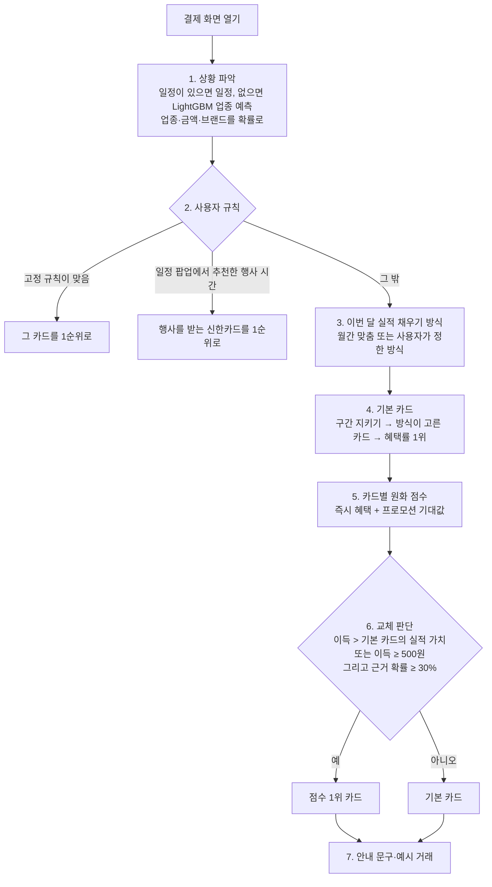
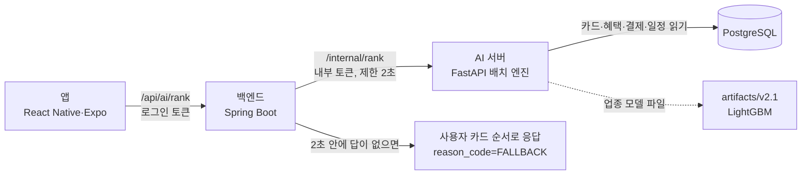

# Pay·Mate 카드 배치 알고리즘 설계서

> 기준: 저장소 `main`(dbc638d, 2026-11-25), 배치 엔진 v4.2, 데이터 v2.1(가상 고객 1,005명), 업종 모델 `artifacts/v2.1`.
> 이 문서의 설정 값은 `solpay-ai/engine/params.py` 의 기본값이고, 수치는 엔진 코드로 다시 돌린 결과다.
> 예전 설계 기록(v4.2 를 처음 만들 때의 실험·결정 이력)은 `2026-11-17-placement-algorithm-redesign-design.md` 에 남겨 두었다.

## 1. 개요

Pay·Mate 는 결제 화면을 열 때 **가진 카드 중 지금 내기 가장 좋은 카드 한 장을 맨 앞에 두고, 왜 그 카드인지 한 줄로 알려 준다.**
결제 카드는 사용자가 최종 선택하고, 엔진은 카드 순서와 안내 문구만 정한다.

카드를 고르는 일이 어려운 이유는 두 가지다.

- 같은 결제라도 시간·가게·이번 달 남은 한도에 따라 가장 좋은 카드가 달라진다.
  예: 신한카드 Discount Plan+ 는 오전 7시~오후 3시 스타벅스 10% 할인(건당 최대 1천 원)인데, 오후 4시에는 같은 결제에 할인이 없다.
- 이번 달 어느 카드로 냈는지가 **다음 달 혜택**을 바꾼다. 대부분의 카드는 지난달 결제액(전월 실적)으로 이번 달 혜택 구간을 정한다.

그래서 엔진은 "지금 혜택"과 "다음 달 혜택(실적)"을 함께 원 단위로 따져 한 장을 고른다. 한눈에 보면 이렇다.



| 구현된 기능 | 하는 일 | API |
|---|---|---|
| 결제 화면 카드 배치 | 위 흐름으로 1순위 카드 1장 + 안내 문구 + 예상 혜택을 보여 줄 예시 거래 | `POST /internal/rank` |
| 홈 일정 카드 미리보기 | 같은 계산, 추천 기록만 남기지 않음(`record: false`) | `POST /internal/rank` |
| 하루 시간표 | 오늘 시간대마다 1순위 카드 (홈 '오늘의 카드 시간표') | `POST /internal/users/{id}/day-placement` |
| 하루 일정 | 일정 시간에는 그 일정의 업종으로 배치 (암호화 저장, 지난 날은 삭제) | `PUT·GET·DELETE …/schedules/{day}` |
| 일정 팝업 | 일정을 저장하면 3일마다 새 신한카드, 그 외 날은 일정에 맞는 행사 추천 | `POST …/schedule-popup` |
| 실적 채우기 방식 | 사용자·달마다 지난 결제로 방식을 비교해 고름 | `GET …/strategy`, `POST …/strategy/initialize` |
| 사용자 규칙 | 고정·제외·실적 안 채움·방식 지정·성향 (챗봇이 초안을 만들고 사용자가 저장) | `…/rules`, `/internal/rules/*` |

## 2. 용어

| 용어 | 뜻 |
|---|---|
| 실적 / 전월 실적 | 한 달 동안 그 카드로 결제한 합계 / 지난달 실적. 이번 달 혜택 구간을 정한다 |
| 구간 | 전월 실적에 따라 혜택이 달라지는 단계. 예: 30만 원 이상이면 월 7천 원까지, 60만 원 이상이면 1만 5천 원까지 |
| 현장 결제 | 매장에서 SOL페이 QR·바코드로 내는 결제. **엔진이 카드를 고르는 대상** |
| 고정 결제 | 교통·자동이체·온라인처럼 정해 둔 카드로 나가는 결제. 카드를 바꾸지 않지만 실적에는 들어간다 |
| 기본 카드 | 특별한 이유가 없을 때 1순위에 두는 카드. 보통 이번 달 실적을 채우는 카드 |
| 구간 지키기 | 지난달 받던 구간을 이번 달에 놓칠 카드를 먼저 기본 카드로 두는 것 |
| 구간 가치 G | 그 카드가 한 구간 오르면 다음 달 더 받을 금액. 다른 카드로도 어차피 받는 혜택은 뺀다 |
| 실적 가치 | 이 결제를 기본 카드로 냈을 때 다음 구간에 가까워지는 값(원). **교체 기준**으로 쓴다 |
| 근거 확률 | 점수 1위 카드가 기본 카드보다 더 주는 업종들의 확률 합 |
| 반복 구간 | 같은 요일·시간대 결제가 8건 이상이고 한 업종이 절반 이상인 경우 (예: 평일 8시 카페) |
| 프로모션 | SOL페이 이벤트·마이샵. 마이샵은 앱에서 켜(ON) 둬야 받는다 |
| 습관 결제 | 엔진 없이 평소 쓰던 카드로 결제한 경우. 평가의 비교 기준 |

## 3. 전체 구조



- 앱은 백엔드만 부른다. 백엔드가 로그인 토큰의 사용자 번호를 붙여 AI 서버 `/internal/rank` 를 부른다 (`backend/.../ai/AiService.rank`).
- **2초 제한**: 배치 호출의 읽기 제한은 `ai.rank-timeout-ms`(기본 2,000ms, `AI_RANK_TIMEOUT_MS`), 연결 제한은 500ms 다
  (`AiClient`: `build(baseUrl, token, min(rankTimeoutMs, 500), rankTimeoutMs)`).
- **제한 시간을 넘기거나 AI 서버가 오류면** 백엔드가 `fallbackRank` 로 **사용자가 정해 둔 카드 표시 순서**(`UserCardRepository.findOrderedIds`)를 그대로 돌려준다.
  첫 카드 문구는 "AI 응답이 없어 기본 순서로 보여 드려요", `reason_code=FALLBACK`. 결제 화면이 AI 때문에 멈추지 않게 하려는 것이다.
  앱은 `aiPlacementCore.applyRank` 에서 이 순서를 그대로 쓰고 `fallback: true` 로 표시한다.
- 등록한 카드가 없으면 엔진은 빈 순서(`NO_CARD`)를 돌려준다.
- 숫자(혜택·실적·구간)는 모두 엔진이 계산한다. 배치에는 생성형 AI 를 쓰지 않는다.

## 4. 입력 데이터

카드와 혜택은 팀 최종 DB 의 실제 카드 데이터이고, 고객과 결제는 실제 데이터가 없어 만든 가상 데이터다(`카드서비스_DB_1년_v2.1`, 팀 DB 와 같은 23개 표).

| 항목 | 내용 |
|---|---|
| 카드 | 44장 (신한 18 · KB국민 6 · 하나 6 · BC 5 · NH농협 5 · 롯데 4) |
| 혜택 | 311개, 전월 실적 구간별 762행 (구간별 한도·혜택 묶음 한도·카드 통합 한도 포함) |
| 업종·가맹점 | 업종 58개, 가맹점 660곳, 별칭 21개 |
| 프로모션 | 29건 (마이샵 23 · 이벤트 6, 신한카드 결제 대상). DB `promotions` 표 하나를 앱·챗봇·엔진이 같이 읽는다 |
| 고객 | 1,005명 (직업 10종 × 20~60대, 시연 계정 1~5번). 보유 카드 2장 181명 · 3장 385명 · 4장 302명 · 5장 137명 |
| 결제 | 2025-11-01 ~ 2026-11-26, 1,129,900건, 약 207.5억 원. 현장 QR 534,767 · 교통 446,621 · 온라인 85,005 · 자동이체 63,507 |
| 하루 일정 | 앱에서 입력한 그날 일정(업종·시작·끝·금액). 장소나 메모는 받지 않고 암호화해 저장, 그날이 지나면 지운다 |
| 사용자 규칙 | 챗봇 초안을 사용자가 저장한 규칙 (`app` 스키마) |
| 학습 산출물 | `artifacts/v2.1`: 업종 모델 `category_lgbm.txt`, 업종 목록, 전체 사용자 분포 `priors.json` (깃에 올리지 않음, 켤 때 `SOLPAY_ARTIFACTS=artifacts/v2.1`) |

결제 한 건의 혜택은 아래 순서로 계산한다 (`engine/benefit_calc.py`). 가상 결제를 만드는 쪽과 엔진이 같은 코드를 써서 평가와 실제 동작의 계산이 다르지 않다.

1. 그 결제에 해당하는 혜택을 찾는다 (업종, 브랜드 한정 혜택이면 브랜드까지).
2. 조건을 확인한다: 최소 결제액, 전월 실적 구간, 요일·날짜·시간, 결제수단(SOL페이 현장 결제는 간편결제), 이번 달·오늘 사용 횟수.
3. 금액을 계산한다: 비율은 10원 미만 버림, 정액은 결제액을 넘지 않음, 주유 리터당 할인은 1,700원/L 로 환산.
4. 한도로 자른다: 건당 최대 → 묶음 월 한도 → 혜택별 월 한도 → 카드 통합 월 한도.
5. 해당 혜택이 여럿이면 가장 큰 것 하나. 포인트·캐시백·할인은 1포인트 = 1원.

타사 카드 결제는 마이데이터로 다음 날 반영된다고 보고, 그때까지는 실적에 넣지 않는다 (문구에 "(어제까지 기준)").

## 5. 알고리즘 단계

진입점은 `PlacementEngine.rank_state` (`engine/service.py`), 4~6단계는 `engine/ranker.py` 의 `decide` 다.

### 5.1 상황 파악: 지금 어디서 얼마를 결제할까

결제 화면을 연 순간에는 가게를 모른다. 그래서 업종·금액·브랜드를 확률로 정리한 '상황' 목록을 만든다 (`engine/scenarios.build`).
예: "음식점 51%(예상 12,000원), 카페 22%(4,800원), 편의점 15%(3,500원) …"

| 경우 | 상황을 만드는 법 |
|---|---|
| 결제가 정해짐 (`known`) | 그 가맹점·금액 100% |
| **하루 일정 시간** | 일정 시작 30분 전 ~ 끝 30분 뒤(`schedule_lead_min`·`schedule_tail_min`)는 그 일정의 업종·금액. 그사이 같은 업종 현장 결제가 이미 있으면 끝난 일정으로 본다 |
| **반복 구간** | 같은 요일·시간대 결제 8건 이상(`repeat_min_count`), 1위 업종 50% 이상(`repeat_min_share`)이면 그 업종 100% |
| 그 밖 | **LightGBM 업종 예측**. 2% 미만 업종(`min_category_prob`)은 빼고 다시 나눈다 |

**업종 예측 모델 (LightGBM 다중분류, `engine/category_model.py`, 학습 `training/train_category.py`)**

- 입력은 배치 시각에 앱이 알 수 있는 값만 쓴다: 시각, 요일, 주말 여부, 시간대, 직전 결제 업종, 직전 결제 뒤 지난 시간, 오늘 결제 수,
  그 시간대 결제 수, 전체 결제 수, 그 시간대 업종별 비중(업종마다), 전체 업종별 비중(업종마다). 생성기 전용 정답 칸(`choice_reason`)은 쓰지 않는다.
- 업종 32개, v2.1 의 2026-01~06 결제로 학습, 07~10월로 평가. 학습률 0.03, 잎 31, 잎 최소 데이터 40, 특성 비율 0.7, L2 20, max_bin 63, 조기 종료 30회 → 트리 328개.
- 평가(07~10월 195,142건): 1순위 적중 **52.2%**(시간대 빈도 방식 49.3%), 3순위 적중 75.6%(73.5%), 로그 손실 1.624(2.239). 결과 `artifacts/v2.1/category_metrics.json`.
- 모델 파일이 없으면 사용자별 시간대 빈도(v1)로 동작한다.

**금액**: 그 가맹점 금액의 중앙값 → 이력이 5건(`amount_min_history`)보다 적으면 그 업종 중앙값 → 그것도 적으면 전체 사용자의 업종 중앙값. 일정에 금액을 적었으면 그 금액.

**브랜드**: 가맹점을 알면 그 브랜드. 모르면 그 업종에서 사용자가 간 브랜드 비중, 이력이 20건(`prior_strength`)보다 적으면 전체 사용자 비중을 섞는다.
카드 혜택 계산에서는 내 카드 혜택과 관계없는 브랜드를 '그 외'로 묶고, 프로모션 계산에서는 묶지 않는다(행사는 카드 혜택이 없는 브랜드에도 걸리므로).

위치(GPS)는 쓰지 않는다. 가맹점이 붙어 있으면 잘못 안내하기 쉽고 배터리를 쓰기 때문이다.

### 5.2 사용자 규칙

사용자가 챗봇에게 말한 지침이다. 챗봇은 초안만 만들고, 사용자가 저장해야 적용된다 (`engine/rules.py`). 조건은 요일·시각만 붙일 수 있다.

| 규칙 | 예 | 동작 |
|---|---|---|
| 고정 `force` | "주말엔 KB ALL 먼저 보여줘" | 조건이 맞으면 3~6단계를 건너뛰고 그 카드를 1순위로, "설정하신 대로 KB ALL 카드를 먼저 보여 드려요" |
| 제외 `exclude` | "SOL트래블은 추천에서 빼줘" | 후보에서 뺀다 |
| 실적 안 채움 `no_fill` | "SOL트래블은 실적 안 채워도 돼" | 기본 카드 후보에서만 빼고, 점수(즉시 혜택 + 프로모션)로는 그대로 경쟁 |
| 방식 지정 `order` | "첫 구간부터 채워 줘" | 3단계 방식을 고정 (`first_tier`·`main_top`·`value`·`none`) |
| 성향 `preference` | "실적보다 지금 혜택이 중요해" | 교체 기준(실적 가치)의 비중 w2 를 0.5~1.5 배로 |

여러 규칙이 맞으면 조건이 구체적인 규칙, 같으면 최근 규칙이 먼저다 (`resolve`). 고정 대상이 제외되었거나 더 이상 없는 카드면 그 규칙은 건너뛴다.

**일정 팝업 행사 카드**: 일정 팝업이 행사를 추천한 일정 시간에는 그 행사를 받으면서 건당 혜택도 가장 큰 신한카드를 1순위로 둔다
(`_promotion_card`, 문구 "14:00 카페 일정: 메가MGC커피 행사와 … 혜택으로 약 1,100원을 받을 수 있어요"). 고정 규칙이 더 우선이다.

### 5.3 실적 채우기 방식

실적을 채울 카드가 여럿일 때 어느 카드부터 채울지 정한다.

| 방식 | 어떻게 채우나 |
|---|---|
| ① 첫 구간 우선 `first_tier` | 첫 구간의 구간 가치가 큰 카드부터 모든 카드의 첫 구간을 채운 뒤 더 높은 구간 |
| ② 주력 카드 우선 `main_top` | 구간을 올리면 혜택이 가장 많이 느는 카드를 닿을 수 있는 가장 높은 구간까지, 남으면 다음 카드 |
| ③ 가치 최대 `value` | 남은 예상 결제 안에서 (구간 가치 − 채우느라 포기하는 혜택) 합이 가장 큰 구간 조합 |
| ④ 실적 안 채움 `none` | 구간을 채우지 않고 지난달 현장 결제 혜택률 1위 카드를 기본 카드로 |

①~③은 먼저 **채울 가치**를 본다: 구간 가치 G < 남은 필요액 N × (혜택률 1위 카드 − 이 카드의 혜택률)이면 채우지 않는다 (`base_value_check`).
예상 결제 + 흔들림 2σ(`unreachable_sigma`)로도 닿지 않는 구간은 건너뛴다.

**월간 맞춤 방식** (`adaptive_months = 6`): 매달 초, 직전 6개월의 본인 결제(그때 보이던 것만)를 후보 방식(최초 방식 + ①~④)마다 다시 흘려
받았을 혜택이 가장 큰 방식을 그달에 쓴다. 비교 기간 현장 결제가 10건(`adaptive_min_payments`)보다 적으면 최초 방식을 그대로 쓴다.
사용자가 방식을 정했으면(방식 지정 규칙) 월간 맞춤을 쓰지 않는다. 사용자·달마다 한 번만 계산해 둔다(`strategy_cache`).

이 모의 계산 안에서 "다른 카드로 바꿀지"는 **고정 기준 150원**(`switch_threshold`)으로 정한다 (`engine/strategy.py`: 이득 ≥ `params.switch_for(금액)`).
150원은 구간 가치 계산(`perf_value`)과 놓친 혜택·카드 추천(`recommend`, `service.missed_benefit`)에서도 쓴다. **실시간 교체 기준은 아래 5.6 의 실적 가치다.**

### 5.4 기본 카드

아래 순서로 처음 맞는 것을 고른다 (`choose_base`). 기본 카드를 두는 이유는 실적을 계획대로 채우고, 결제마다 1순위가 바뀌어 화면이 어지럽지 않게 하기 위해서다.

1. **구간 지키기** (`hold_tiers = True`): 지난달 받던 구간을 이번 달에 놓칠 카드가 있고, 남은 금액을 이번 달 안에 채울 수 있고, 채울 가치가 있으면(`hold_worth_check`) 그 카드. 여러 장이면 남은 금액이 가장 적은 카드.
2. **방식이 고른 카드**: 5.3 의 방식이 지금 채우라고 고른 카드.
3. **혜택률 1위** (`base_fallback = best_rate`): 채울 카드가 없거나 방식 ④면, 지난달 현장 결제를 이 카드로 냈을 때 혜택률이 가장 높은 카드.

계산에 쓰는 값 (`engine/perf_value.py`):

```
남은 필요액 N   = 구간 하한 − 이번 달 실적 − (지난달 교통·자동이체·온라인 일평균 × 남은 일수)
남은 예상 결제 B = 지난달 현장 결제 일평균 × 남은 일수   (남은 일수 = 말일 − 오늘 + 0.5)
흔들림 σ        = 지난달 현장 결제 일평균 × √남은 일수
구간 가치 G     = 지난달 결제를 결제마다 가장 좋은 카드로 냈다고 다시 계산할 때, 그 카드만 그 구간에 올렸다면 늘었을 혜택
채울 가치       : G ≥ N × (혜택률 1위 카드의 혜택률 − 이 카드의 혜택률)
```

### 5.5 카드별 원화 점수

카드마다 "이 카드로 지금 결제하면 몇 원을 받는가"를 계산한다 (`score_cards`). 원 단위라 카드끼리 바로 비교한다.

```
점수(카드) = 즉시 혜택 + 프로모션 기대값                      (w1 = 1, w3 = 1, 점수에 실적 가치는 넣지 않음)
즉시 혜택   = Σ 업종 P(업종) × Σ 브랜드 P(브랜드|업종) × 혜택 계산(카드, 업종, 브랜드, 예상 금액, 지금 시각)
프로모션    = Σ 업종 P(업종) × Σ 브랜드 P'(브랜드|업종) × 가장 큰 행사 금액(카드, 예상 금액, 지금 시각)
```

- 이번 달 남은 한도와 사용 횟수를 반영하므로 한도를 다 쓴 카드는 점수가 내려간다.
- 행사는 신한카드 결제에만 붙고 기간·최소 결제액·건당 상한을 지킨다. 결제 한 건에는 행사 하나(가장 큰 것)만 센다.
- 응모·선착순 조건(`needs_check`)이 있는 행사는 점수에서 뺀다.

예 (반복 구간, 카페 100%·6,000원, 이 사용자의 카페 결제는 할리스 80%·메가MGC커피 20%, 할리스 마이샵 10%):

| 카드 | 즉시 혜택 | 프로모션 기대값 | 점수 |
|---|---|---|---|
| 신한카드 Discount Plan+ | 0.2 × 600 = 120원 (메가MGC커피 오전 10%) | 0.8 × 600 = 480원 | 600원 |
| 신한 모두의카드 | 0원 (2만 원 미만) | 480원 | 480원 |
| KB ALL 카드 | 60원 (국내 1%) | 0원 (신한카드 행사) | 60원 |

### 5.6 교체 판단

점수 1위 카드가 기본 카드와 다르면, 아래 두 조건을 **모두** 만족할 때만 바꾼다 (`v4_swap`).

1. **이득이 충분하다**: 이득(= 1위 점수 − 기본 카드 점수) > 교체 기준(= 기본 카드의 실적 가치 × w2), **또는 이득 ≥ 500원**(`big_gain_swap`).
2. **근거가 있다**: 근거 확률 ≥ 30%(`evidence_prob`) **또는** 반복 구간.

```
다음 구간     = 기본 카드 구간 중 이번 달 실적보다 높은 가장 낮은 구간
달성 확률 p   = Φ((B − N) / σ)         (Φ: 표준정규 누적분포)
예상 금액 a   = Σ 업종 P(업종) × 그 업종 예상 금액
교체 기준     = min(a, N) × G × p ÷ N   (다음 구간이 없거나 N ≤ 0 이거나 G ≤ 0 이면 0원)
```

- 금액에 비례한다: 같은 카드라도 6,700원 결제의 기준은 작고 5만 원 결제의 기준은 크다.
- 구간을 이미 채웠으면 0원이라 점수가 더 높은 카드로 바로 바꾼다.
- 예: N = 12만 원, G = 9,600원, B = 30만 원, σ = 10만 원이면 p = Φ(1.8) ≈ 0.96, 100원당 실적 가치 ≈ 7.7원 → 6,700원 결제의 기준 515원, 5만 원 결제 3,840원.
- **500원 예외**(2026-11-23 팀 결정): 실적 가치로 막힌 결제의 76%는 월말에 보면 그 결제 없이도 구간을 채웠다. 365명 재생에서 혜택률 1.316% → 1.324%, 실적 충족 61.7% → 61.6%.
- 화면에는 **항상 1장**(`max_display = 1`)을 보여 준다. 나머지 카드는 점수 순서로 뒤에 둔다.

### 5.7 안내 문구와 예시 거래

1순위 카드 아래 한 줄 문구의 금액은 모두 엔진이 계산한 값이다 (`engine/messages.py`, `reason_code`).

| 코드 | 언제 | 예 |
|---|---|---|
| `AMOUNT_BENEFIT`·`TIME_BENEFIT`·`GENERAL_BENEFIT` | 혜택 때문에 고름 (금액·시간 조건 등) | "음식점에서 결제하면 1.5% 적립을 받을 수 있어요!" |
| `HOLD` | 구간 지키기 | "신한카드 Discount Plan+ 120만 원 구간까지 186,210원 남았어요. 채우면 다음 달에도 지금 혜택을 받아요" |
| `PERFORMANCE` | 실적 채우기 | "신한 모두의카드 실적 달성까지 138,000원 남았어요!" |
| `PROMOTION` | 점수 차이가 주로 행사. 기대 금액이 100원(`promo_message_min`) 미만이면 카드 혜택 문구로 | "현대백화점 마이샵 15%로 약 700원을 더 받을 수 있어요!" |
| `PROMOTION_CARD` | 일정 팝업 행사 시간 | "14:00 카페 일정: …" |
| `RULE` | 고정 규칙 | "설정하신 대로 … 먼저 보여 드려요" |
| `BASE_CHANGED` | 직전 기본 카드가 이번 달 구간을 실제로 채웠을 때만 | "앞 카드 실적을 채워 오늘부터 …를 먼저 보여 드려요" |
| `HABIT` / `NEUTRAL` | 말할 혜택이 없을 때. 최근 두 달 그 시간대에 그 카드를 가장 많이·3번 이상 썼으면 습관 문구, 아니면 중립 | "보통 지금 시간대에 이 카드로 계산하셨어요!" / "지금은 카드마다 혜택 차이가 크지 않아요." |

소비를 늘리라는 표현은 쓰지 않는다. 응답의 `example`(`engine/example.py`)은 문구가 가리키는 거래(가맹점·금액)로,
앱 결제 화면 '이 거래의 예상 혜택'이 이 거래로 카드별 혜택을 다시 계산해 보여 준다.

### 5.8 일정 팝업과 하루 시간표

- **일정 팝업** (`engine/popup.py`): 일정을 저장하면 3일(`recommend_interval_days`)마다 아직 없는 신한카드 중 월 이득(연회비 월 환산 뺌)이 3,000원(`recommend_min_monthly`) 이상인 카드를,
  그 외 날은 일정 업종에 맞는 행사를 최대 2건(`popup_promotions`) 추천한다. 같은 카드 다시 추천 금지 기간은 2026-11-24 팀 결정으로 끔(`recommend_same_card_days = 0`).
- **하루 시간표** (`engine/day_plan.py`): 오늘 시간대마다 같은 배치를 돌려 1순위 카드가 바뀌는 시각을 묶는다. 홈 '오늘의 카드 시간표'와 챗봇 `get_day_plan` 이 쓴다.

## 6. 설정 값 (`engine/params.py` 기본값)

| 묶음 | 이름 | 값 | 뜻 |
|---|---|---|---|
| 엔진 | `engine` | `v4` | 점수 = 즉시 혜택 + 프로모션, 교체 기준 = 실적 가치, 1장 |
| | `promo_in_score` | `True` | 프로모션을 점수에 넣음 (v4.2) |
| | `max_display` | 1 | 보여 주는 카드 수 |
| 점수 | `w1`·`w2`·`w3` | 1.0 | 즉시 혜택·실적 가치·프로모션 비중 (성향 규칙은 0.5~1.5) |
| 교체 | `big_gain_swap` | 500원 | 이득이 이 이상이면 실적 가치를 넘지 않아도 교체 |
| | `evidence_prob` | 0.3 | 근거 확률 최소값 |
| | `switch_threshold` | 150원 | 방식 비교 모의 계산·구간 가치·놓친 혜택·카드 추천의 교체 기준 (실시간 배치에는 쓰지 않음) |
| 기본 카드 | `base_order` | `auto` | 사용자·달마다 방식 선택 (월간 맞춤) |
| | `hold_tiers`·`hold_worth_check` | `True` | 구간 지키기, 채울 가치 확인 |
| | `first_tier_order` | `value` | 방식 ① 은 구간 가치가 큰 카드부터 |
| | `base_value_check` | `True` | 채울 가치가 없는 카드는 기본 카드로 삼지 않음 |
| | `base_fallback` | `best_rate` | 채울 카드가 없으면 혜택률 1위 |
| | `unreachable_sigma` | 2.0 | 예상 + 2σ 로도 못 닿는 구간은 건너뜀 |
| | `tier_gain_mode` | `marginal` | 구간 가치는 다른 카드로도 받는 몫을 뺀 증분 |
| 월간 맞춤 | `adaptive_months` | 6 | 직전 6개월로 방식 비교 |
| | `adaptive_min_payments` | 10 | 현장 결제가 이보다 적으면 최초 방식 |
| 상황 | `schedule_lead_min`·`schedule_tail_min` | 30분 | 일정 앞뒤로 그 일정으로 보는 시간 |
| | `min_category_prob` | 0.02 | 이보다 작은 업종은 뺌 |
| | `repeat_min_count`·`repeat_min_share` | 8건·0.5 | 반복 구간 조건 |
| | `prior_strength` | 20 | 이력이 적으면 전체 분포를 섞는 기준 |
| | `amount_min_history` | 5 | 금액 이력이 적으면 업종·전체 중앙값 |
| 문구 | `promo_message_min` | 100원 | 행사 문구 최소 금액 |
| 꺼 둔 기능 | `month_end_days`·`loss_guard_months`·`perf_budget_share`·`perf_net_value` | 0·0·False·False | 재생에서 효과가 없어 끔 |

백엔드: `AI_RANK_TIMEOUT_MS` 2,000ms(배치), `AI_TIMEOUT_MS` 20,000ms(챗봇 등), `AI_CLASSIFY_TIMEOUT_MS` 3,000ms(일정 직접 입력 분류).

## 7. 실패·예외 처리

| 상황 | 처리 |
|---|---|
| AI 서버가 2초 안에 답하지 못함·오류 | 백엔드가 사용자 카드 표시 순서로 응답 (`FALLBACK`, "AI 응답이 없어 기본 순서로 보여 드려요"). 결제는 그대로 진행 |
| 업종 모델 파일 없음 | 시간대 빈도(v1)로 업종 확률 |
| 등록 카드 없음 | 빈 순서 (`NO_CARD`), 기록 없음 |
| 결제 이력이 적은 새 고객 | 금액·브랜드는 전체 사용자 분포를 섞고, 방식은 최초 방식(현장 결제 10건 미만이면 주력 카드 우선) |
| 고정 대상 카드를 더 이상 보유하지 않음 | 그 규칙을 건너뜀 |
| 홈 미리보기 | `record: false` 로 같은 계산만 하고 추천 기록을 남기지 않음 (기록의 기본 카드가 다음 배치의 '직전 기본 카드'가 되므로) |
| 일정 동기화 실패 | 일정 저장은 성공시키고 AI 전달은 경고 로그 후 다시 보냄 (`POST /api/ai/schedules/{day}/sync`) |
| 사용자·달의 첫 호출이 느림 | 실적 모의 계산을 사용자·달마다 한 번 한다. 공용 RDS 에서 첫 호출 0.9~1.9초 → 2초 제한 안이지만 넘으면 위 FALLBACK |

## 8. API

| 경로 | 설명 |
|---|---|
| `POST /internal/rank` | 본문 `user_id`, `at`(생략 시 지금), `explain`(근거 포함), `record`(기본 true). 응답 `cards[{user_card_id, rank, score_won, message}]`, `display_count`, `reason_code`, `version`(schedule·pattern), `scenario_mode`, `base_card`, `example`, `recommendation_id` |
| `POST /internal/users/{id}/day-placement` | 오늘 시간대별 1순위 카드 |
| `PUT·GET·DELETE /internal/users/{id}/schedules/{day}` | 하루 일정 |
| `POST /internal/users/{id}/schedule-popup` | 일정 팝업 |
| `GET /internal/users/{id}/strategy`, `POST …/strategy/initialize` | 이번 달 방식과 비교 결과 |
| `GET·PUT /internal/users/{id}/rules`, `POST /internal/rules/validate` | 사용자 규칙 |
| 백엔드 `GET /api/ai/rank?record=false` | 앱이 부르는 주소 (로그인 토큰에서 사용자 번호) |

모든 `/internal/*` 는 내부 토큰(`SOLPAY_INTERNAL_TOKEN`)이 있어야 한다. 전체 명세는 `solpay-ai/openapi.json`.

## 9. 검증

### 9.1 혜택률 평가 (재생)

- **방법**: 2026-07-01 ~ 11-05 를 하루씩 다시 돌린다. 결제 때마다 그 시점까지의 정보만으로 엔진이 1순위를 고르고, 그 카드로 결제했다고 보고 혜택을 계산한다.
  업종 모델은 1~6월로 학습했으므로 평가 기간은 모델이 보지 않은 기간이다.
- **대상**: v2.1 고객 1,005명, 결제 202,288건(66.7억 원).
- **표준 조건**: 평소와 다른 결제의 30%·일반 결제의 10%에 일정 입력, 일정 팝업, 행사 29건. 마이샵은 습관 결제에서 30%만 켰다고 보고, 엔진은 같은 30%에 더해 앱이 알려 준 마이샵은 켠다고 본다.
- **비교 기준**: 습관(평소 쓰던 카드).

| 항목 | 엔진 | 습관 | 차이 |
|---|---|---|---|
| 혜택률 (받은 혜택 ÷ 결제액) | **1.326%** | 0.811% | **+0.515%p** (95% 구간 0.492~0.540) |
| 받은 혜택 합 | 8,845만 원 | 5,409만 원 | +3,436만 원 |
| 1인 월평균 더 받음 | | | 8,205원 |
| 전월 실적 채운 비율 | 60.1% | 48.7% | +11.4%p |

- 더 받은 사람 964명(95.9%), 같은 사람 4명, **손해 37명(3.7%)**. 37명의 손해 합 −180,670원, 1인 중앙값 −2,820원.
- 결제의 20.8%에서 평소 카드가 아닌 카드를 추천했다. 다음 결제 업종 1순위 적중 58.1%.

**상한과 비교**

| 기준 | 혜택률 |
|---|---|
| 습관 | 0.811% |
| 지금 엔진 | 1.326% |
| 예측이 완벽하다면 (그날 결제를 미리 앎, 같은 엔진) | 1.528% |
| 사후 최적 (결제를 다 본 뒤 실적 목표까지 골라 계산, 마이샵 30%) | 1.536% |

확보율 = (엔진 − 습관) ÷ (사후 최적 − 습관) = **71.1%**. 남은 0.21%p 의 약 96% 는 결제 예측에서 생긴다(예측이 완벽하면 사후 최적과 0.008%p 차이).

**조건을 바꾸면**

| 조건 | 혜택률 | 손해 | 업종 1순위 적중 |
|---|---|---|---|
| 표준 | 1.326% | 37명 | 58.1% |
| 일정 입력 없음 | 1.267% | 55명 | 52.3% |
| 업종 예측을 시간대 빈도로 | 1.326% | 41명 | 55.5% |
| 신규 가입자 (학습에서 뺀 200명, 7월 가입) | 1.094% (습관 0.706%) | — | 56.2% |

**손해 37명의 원인**: 손해의 57% 는 습관 카드가 전월 실적 첫 구간에 근소하게 못 미친 것(남은 필요액에 여유분을 두지 않음),
39% 는 습관 카드에 켜 둔 마이샵 행사(현대백화점 등 10건)를 다른 카드로 옮기며 놓친 것이다. 이들은 습관이 이미 사후 최적의 77%(나머지 54%)를 받고 있어
작은 실수에 손익이 뒤집힌다. 재택·야근이 22명으로 많은데, 엔진이 고를 수 있는 현장 결제 비중이 53%(나머지 64%)로 작기 때문이다.
대책(첫 구간 여유분 등)은 넣지 않고 엔진을 그대로 두기로 했다(2026-11-24 팀 결정).

### 9.2 규칙 점검

표본 45명, 배치 9,361건, 같은 조건으로 두 번 돌려 문제 **0건**.

| 점검 | 문제 |
|---|---|
| 추천 카드가 모두 내 카드인가 / 같은 카드가 두 번 나오나 / 내 카드가 빠지나 | 0 / 0 / 0 |
| 표시 장수(1~2장)가 맞나 / 1순위 카드로 결제했나 | 0 / 0 |
| 받은 혜택이 그 결제의 최대보다 큰가 / 두 번 돌리면 결과가 다른가 | 0 / 0 |

### 9.3 속도

- 엔진 계산만 (재생 202,288건): 중앙 4.5ms, **95% 11.4ms**, 99% 18.9ms, 최대 125ms.
- 공용 RDS 에 붙이면 DB 왕복이 더해져 사용자·달의 첫 호출 0.9~1.9초, 그다음 중앙 약 150ms. 백엔드 제한 2초 안이다.

### 9.4 자동 테스트

- AI 서버 `solpay-ai/tests`: 2026-11-25 `main` 에서 692개 수집 (`pytest --collect-only`). 배치 관련은 `test_v41.py`·`test_promo_score.py`·`test_replay_myshop.py`·`test_strategy*.py` 등.
  DB 가 필요한 시험은 로컬 시험 DB 가 있을 때만 돈다.
- 발표 기준 수치: 자동 테스트 959개 (AI 650 · 백엔드 157 · 앱 152, 11-24 집계).

재현: 재생 평가 스크립트는 `solpay-ai/artifacts/v2.1/eval/run_eval.py`·`report.py` 이고 산출물 폴더라 깃에는 없다.
결과 요약은 위 표와 같고, 사후 최적(마이샵 30%) 계산은 약 9시간 걸린다.

## 10. 한계와 남은 일

- **가상 데이터다.** 생성기의 소비 패턴 위에서 잰 값이라 실제 고객에게 같은 숫자가 나온다는 보장은 없다. "같은 세계에서 습관 대비 얼마나 나은가"를 보는 값이다.
- **늘 1순위 카드로 결제한다고 가정했다.** 추천을 따르지 않는 결제가 있으면 효과가 줄어든다.
- **마이샵 30%·일정 입력 비율은 가정이다.** 마이샵 ON 상태를 앱과 연동하면 가정을 줄일 수 있다.
- **업종 예측이 남은 차이의 대부분이다.** 일정 입력이 가장 큰 개선 수단이다 (일정 없음 1.267% → 표준 1.326%).
- 백화점·헬스앤뷰티처럼 드물게 가는 업종은 시간대 예측이 거의 맞지 않는다. 위치를 쓰지 않으므로 일정으로만 보완된다.
- 손해 고객 대책(첫 구간 여유분, 켜 둔 마이샵 보호)은 검토만 하고 넣지 않았다.

## 부록. 코드 위치

| 파일 | 내용 |
|---|---|
| `solpay-ai/engine/service.py` | 진입점 `PlacementEngine.rank_state`, 일정 행사 카드, `PlacementService` |
| `solpay-ai/engine/scenarios.py` | 1단계 상황 (일정·반복 구간·업종 예측·금액·브랜드) |
| `solpay-ai/engine/category_model.py`, `training/train_category.py` | LightGBM 업종 모델 입력·학습 |
| `solpay-ai/engine/rules.py` | 2단계 규칙 |
| `solpay-ai/engine/strategy.py`, `strategy_store.py` | 3단계 방식·월간 맞춤 |
| `solpay-ai/engine/ranker.py` | 4~6단계 기본 카드·점수·교체 (`decide`, `v4_swap`) |
| `solpay-ai/engine/perf_value.py` | 남은 필요액·구간 가치·실적 가치 (`switch_threshold`) |
| `solpay-ai/engine/benefit_calc.py` | 혜택 계산 |
| `solpay-ai/engine/messages.py`, `example.py` | 안내 문구, 예시 거래 |
| `solpay-ai/engine/popup.py`, `day_plan.py` | 일정 팝업, 하루 시간표 |
| `solpay-ai/engine/params.py` | 설정 값 |
| `solpay-ai/evaluation/replay.py`, `oracle.py` | 재생 평가, 사후 최적 |
| `backend/src/main/java/com/paymate/backend/ai/AiClient.java`, `AiService.java` | 2초 제한, FALLBACK |
| `frontend/utils/aiPlacement.js`, `aiPlacementCore.js` | 앱에서 순위 적용 |
